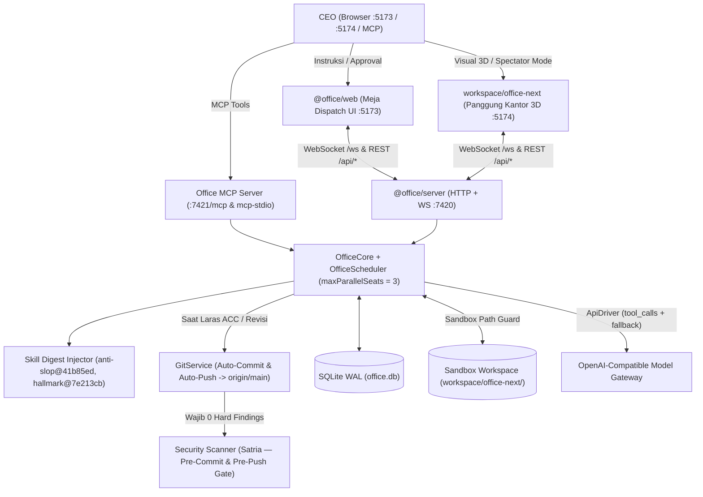

# Arsitektur Teknis Office Agents (`docs/ARCHITECTURE.md`)

Dokumen ini menjelaskan arsitektur teknis end-to-end dari sistem **Office Agents v1.1.0** yang mengoordinasikan **10 karyawan AI spesialis** melalui server orkestrasi Node.js + SQLite (`@office/server`), server MCP (`:7421/mcp`), antarmuka **Meja Dispatch** (`@office/web`), serta panggung **Kantor Virtual 3D Isometrik** (`workspace/office-next/`).

---

## 1. Diagram Alur Sistem

---

## 2. Lapisan Paket Monorepo

### 2.1 `@office/shared` (`packages/shared/src/index.ts` — `SCHEMA_VERSION = '1.1.0'`)
Kontrak tunggal yang dipakai bersama oleh backend, frontend (`@office/web` & `workspace/office-next/`), dan MCP:
- **10 Peran Agen (`AGENT_ROLES`):**
  - `manager` (`Raka`), `researcher` (`Sari`), `writer` (`Dimas`), `coder` (`Bima`), `gamedev` (`Gita`), `designer` (`Tari`), `artist` (`Wulan`), `reviewer` (`Laras`), `visual_qa` (`Fajar`), `security` (`Satria`).
- **Matriks Hak Akses Tool per Peran:**
  - `FILE_WRITING_ROLES`: `writer`, `coder`, `gamedev`, `artist`, `designer`
  - `COMMAND_ROLES`: `coder`, `gamedev`, `visual_qa`
  - `SECURITY_SCAN_ROLES`: `security` (`Satria`)
  - `PLAYWRIGHT_AUTO_APPROVE_ROLES`: `visual_qa` (`Fajar` untuk `npx playwright test` di mode `full`)
- **20 Tool Kanonik (`TOOL_SCHEMAS`):**
  - Komunikasi: `send_message`, `broadcast`
  - Tugas: `create_task`, `update_task`, `list_tasks`
  - Proyek: `create_project`, `get_project_context`
  - File (`workspace/`): `list_files`, `read_file`, `write_file`, `edit_file`
  - Eksekusi & Git: `run_command`, `git_status`, `git_diff`, `git_commit`, `git_log`
  - Keamanan: `security_scan`
  - Memori & Kontrol: `save_note`, `recall_notes`, `request_approval`

### 2.2 `@office/server` (`apps/server/src/`)
1. **`db.ts` (`OfficeDb`):**
   - Menggunakan modul bawaan `node:sqlite` (`DatabaseSync`) dengan `PRAGMA journal_mode = WAL`.
   - Menyimpan 10 tabel: `kv`, `projects`, `agents`, `tasks`, `messages`, `runs`, `approvals`, `notes`, `usage_daily`, dan `audit_log`.
2. **`core/office-core.ts` (`OfficeCore`):**
   - Menangani seluruh `ClientCommand` dari UI dan menegakkan matriks hak akses per peran untuk ke-20 tool.
   - Memicu `GitService.commitAndPushTask()` secara otomatis saat `Laras` (`reviewer`) memberikan **ACC** (`review -> done`) atau mengembalikan tugas untuk revisi (`review -> in_progress`).
3. **`security/scanner.ts` (`runSecurityScan`):**
   - Pemindai keamanan deterministik yang mendeteksi kebocoran API key/token, file terlarang (`.env`, `*.pem`, `*.key`, `*.db`, `*.sqlite`), modifikasi `package.json`/lockfile oleh agen, serta pola prompt injection.
   - Mengembalikan temuan yang sudah disamarkan (`rule`, `path`, `line`, `severity` — tanpa pernah menampilkan nilai rahasia mentah).
4. **`git/git-service.ts` (`GitService`):**
   - Menjalankan `runSecurityScan` sebelum staging/commit dan sebelum `git push`.
   - Membuat commit murni atas nama author pemilik repositori (`Muhayara <hafizhajah777@gmail.com>`) tanpa trailer `Co-authored-by`, dengan atribusi agen di judul commit: `<type>(3d): <ringkasan tugas> [by <Nama> — <Jabatan>]`.
5. **`skills.ts` (`buildSkillsPromptBlock`):**
   - Menyuntikkan intisari `DIGEST.md` (`<= 120` baris, `<= 4000` karakter) dari `skills/vendor/anti-slop@41b85ed/` (semua 10 kursi) dan `skills/vendor/hallmark@7e213cb/` (`Tari`, `Wulan`, `Gita`).
6. **`core/scheduler.ts` (`OfficeScheduler`):**
   - Menjadwalkan hingga **3 kursi berjalan paralel** (`maxParallelSeats = 3`) dengan batas `maxStepsPerTurn = 16` dan `maxTurnsPerTask = 40`.

### 2.3 `@office/web` (`apps/web/src/`) & `workspace/office-next/`
- **`@office/web` (`:5173`):** Meja Dispatch utama dengan 10 kursi dinamis, indikator status Git real-time di bar atas (`StatusRail.tsx`), papan Kanban 5 kolom, aliran pesan kantor, dan panel Audit Keamanan `Satria` di `DetailRail.tsx`.
- **`workspace/office-next/` (`:5174`):** Ruang Kantor Virtual 3D Isometrik yang mengimpor `@office/shared` langsung dari root monorepo dan mendukung **Mode Pengunjung (*Spectator View-Only Mode*)** maupun **Mode CEO**.

---

## 3. Endpoint HTTP, WebSocket, & MCP

| Port | Endpoint | Metode | Fungsi |
|---:|---|---|---|
| `7420` | `/health` | `GET` | Status kesehatan server & latensi gateway model |
| `7420` | `/api/state` | `GET` | Snapshot lengkap state kantor (`StateSnapshot` v1.1.0) |
| `7420` | `/api/files` | `GET` | Daftar file di dalam `workspace/` |
| `7420` | `/api/file?path=...` | `GET` | Membaca isi file di dalam `workspace/` |
| `7420` | `/api/command` | `POST` | Mengirim `ClientCommand` via HTTP |
| `7420` | `/api/gateway/check` | `POST` | Memeriksa ulang koneksi ke gateway model |
| `7420` | `/ws` | `WS` | Aliran dua arah `ServerEvent` & `ClientCommand` |
| `7421` | `/mcp` | `POST` | Endpoint Streamable HTTP MCP |
