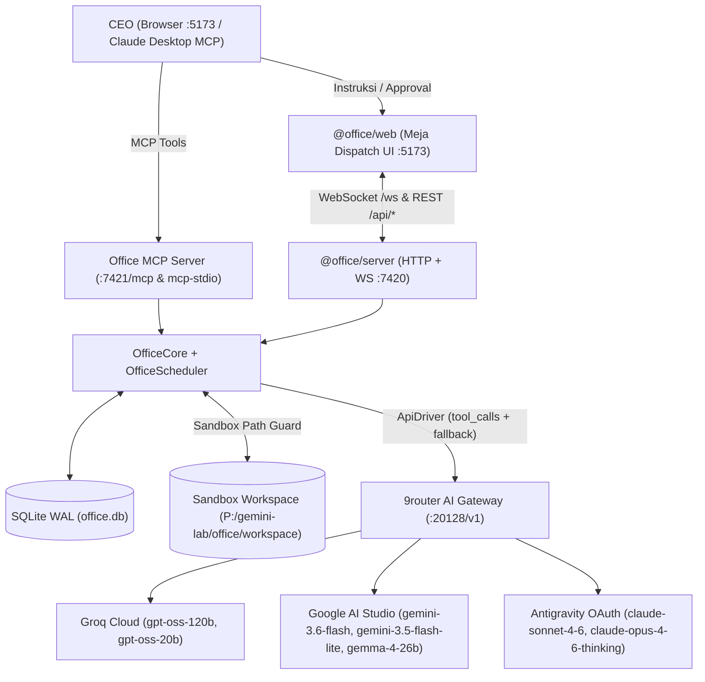

# Arsitektur Teknis Office Agents (`docs/ARCHITECTURE.md`)

Dokumen ini menjelaskan arsitektur teknis end-to-end dari sistem **Office Agents** yang menghubungkan 5 karyawan AI melalui gateway `9router`, server orkestrasi Node.js + SQLite (`@office/server`), server MCP (`:7421/mcp`), dan antarmuka web **Meja Dispatch** (`@office/web`).

---

## 1. Diagram Alur Sistem

---

## 2. Lapisan Paket Monorepo

### 2.1 `@office/shared` (`packages/shared/src/index.ts`)
Kontrak tunggal yang dipakai bersama oleh backend, frontend, dan MCP:
- **Skema & Tipe Data:** `AgentView`, `Task`, `Message`, `Approval`, `Usage`, `StateSnapshot`, `ServerEvent`, dan `ClientCommand`.
- **Aturan Transisi Tugas (`TASK_TRANSITIONS`):**
  - `todo -> in_progress | blocked`
  - `in_progress -> review | blocked | todo`
  - `review -> done | in_progress | blocked`
  - `blocked -> todo | in_progress`
- **19 Tool Kanonik (`TOOL_SCHEMAS`):**
  - Komunikasi: `send_message`, `broadcast`
  - Tugas: `create_task`, `update_task`, `list_tasks`
  - Proyek: `create_project`, `get_project_context`
  - File (`workspace/`): `list_files`, `read_file`, `write_file`, `edit_file`
  - Eksekusi & Git: `run_command`, `git_status`, `git_diff`, `git_commit`, `git_log`
  - Memori & Kontrol: `save_note`, `recall_notes`, `request_approval`

### 2.2 `@office/server` (`apps/server/src/`)
1. **`db.ts` (`OfficeDb`):**
   - Menggunakan modul bawaan `node:sqlite` (`DatabaseSync`) dengan `PRAGMA journal_mode = WAL`.
   - Menyimpan 10 tabel: `kv`, `projects`, `agents`, `tasks`, `messages`, `runs`, `approvals`, `notes`, `usage_daily`, dan `audit_log`.
2. **`core/office-core.ts` (`OfficeCore`):**
   - Menangani seluruh `ClientCommand` dari UI (`ceo.send`, `task.create`, `task.move`, `approval.respond`, `office.setMode`, `office.pauseAll`, `office.stopAgent`, `office.setLanguage`).
   - Mengeksekusi ke-19 tool dengan penegakan hak akses per peran (`FILE_WRITING_ROLES` hanya mengizinkan `writer` dan `coder` memodifikasi file di `workspace/`).
   - Menyiarkan `ServerEvent` secara real-time ke seluruh klien WebSocket yang terhubung.
3. **`drivers/api-driver.ts` (`ApiDriver`):**
   - Menjalankan loop pemanggilan fungsi (`tool_calls`) hingga `maxStepsPerTurn` (default 8 langkah).
   - Mendukung **rantai fallback otomatis**: bila model utama mengembalikan HTTP `429`, `500`, `502`, `503`, atau timeout, driver langsung beralih ke model berikutnya di array `fallbacks`.
   - Mendukung **dual parser JSON/SSE** untuk menangani respons `9router` baik dalam bentuk JSON tunggal maupun aliran `data: {...}`.
   - Menyertakan fallback ekstraksi JSON envelope (`extractEnvelope`) apabila model mengembalikan blok JSON di dalam teks biasa.
4. **`core/scheduler.ts` (`OfficeScheduler`):**
   - Menjadwalkan giliran agen berdasarkan pesan belum terbaca (`unread`) dan tugas aktif (`todo`, `in_progress`, `review`).
   - Membatasi maksimal **2 kursi berjalan paralel** (`maxConcurrent = 2`) dan menghentikan ping-pong otomatis jika melampaui `pingPongLimit`.

### 2.3 `@office/web` (`apps/web/src/`)
Antarmuka **Meja Dispatch** bergaya ruang kendali cetak biru industrial sesuai spesifikasi `docs/DESIGN.md`:
- **`StatusRail.tsx`:** Bar atas 44px berisi status gateway `9router`, sakelar mode `Semi / Penuh`, tombol `Jeda Semua`, badge jumlah izin tertunda, dan pilihan bahasa `ID / EN`.
- **`RosterRow.tsx` & `Tick.tsx`:** Panel kiri 264px menampilkan 5 kursi karyawan AI beserta indikator status geometris dan bar kuota 20-segmen (`Tick`).
- **`WorkOrderBoard.tsx`:** Papan Kanban 5 kolom (`todo`, `in_progress`, `review`, `done`, `blocked`) di bagian atas panggung tengah.
- **`DispatchLog.tsx`:** Aliran pesan kantor real-time dengan filter per agen dan tombol perintah cepat (*quick prompts*) saat kondisi kosong.
- **`CommandComposer.tsx`:** Bar komando CEO di bagian bawah dengan pemilih target (`→ Raka (Manajer)`, `→ Semua`, atau kursi spesifik).
- **`DetailRail.tsx` & `ApprovalModal.tsx`:** Panel kanan 340px menampilkan antrean persetujuan CEO, detail kursi/tugas terpilih, dan daftar file `workspace/` beserta viewer konten file.

---

## 3. Endpoint HTTP, WebSocket, & MCP

| Port | Endpoint | Metode | Fungsi |
|---:|---|---|---|
| `7420` | `/health` | `GET` | Status kesehatan server & latensi gateway `9router` |
| `7420` | `/api/state` | `GET` | Snapshot lengkap state kantor (`StateSnapshot`) |
| `7420` | `/api/files` | `GET` | Daftar file di dalam `workspace/` |
| `7420` | `/api/file?path=...` | `GET` | Membaca isi file di dalam `workspace/` |
| `7420` | `/api/command` | `POST` | Mengirim `ClientCommand` via HTTP |
| `7420` | `/api/gateway/check` | `POST` | Memeriksa ulang koneksi ke `9router` (`:20128/v1/models`) |
| `7420` | `/ws` | `WS` | Aliran dua arah `ServerEvent` & `ClientCommand` |
| `7421` | `/mcp` | `POST` | Endpoint Streamable HTTP MCP (26 tools: 19 tool agen + 7 tool `office_*`) |
