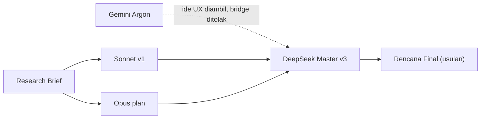
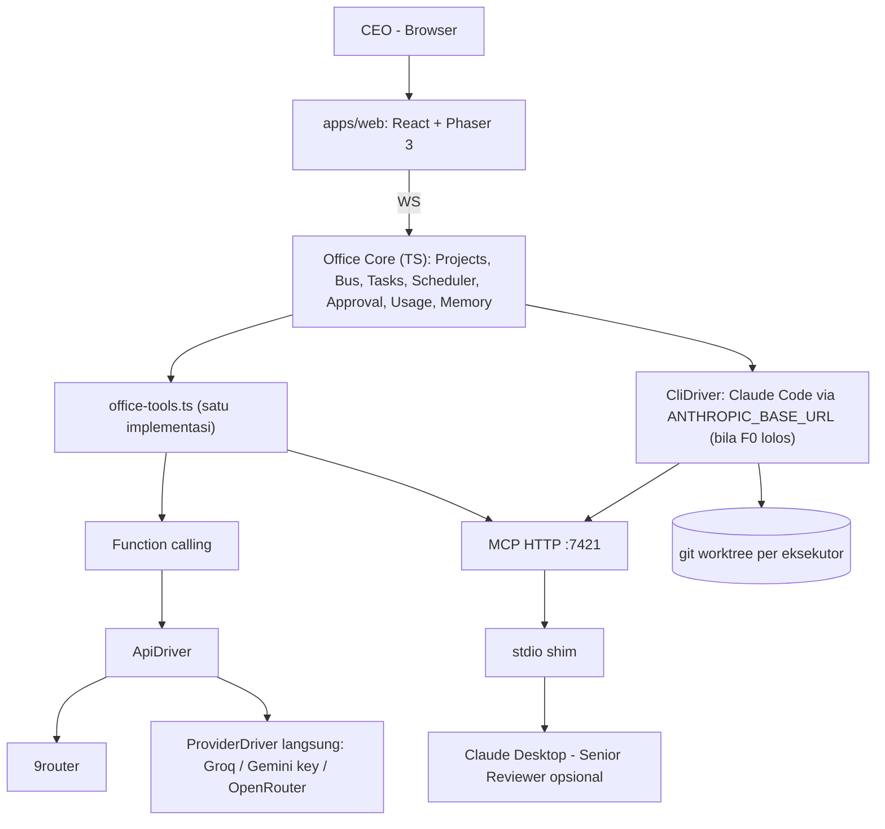

# Analisis Semua Plan: Office Agents AI

*Analisis 5 dokumen di `P:\gemini-lab\office` · 10 Nov 2026*

## 1. Peta Dokumen

| Dokumen | Peran | Stack | Jalur Claude | Kursi | Nilai |
|---|---|---|---|---|---|
| [research-brief-ai-office.md](file:///P:/gemini-lab/office/research-brief-ai-office.md) | Riset dasar | — | CLI resmi saja | — | ⭐⭐⭐⭐ Fondasi kebijakan & prior art |
| [Rancangan…sonnet-5.5.md](file:///P:/gemini-lab/office/Rancangan-Lengkap-Office-Agents-versi-sonnet-5.5.md) | Blueprint v1 | Python + OpenCode | Claude Desktop manual | 3 | ⭐⭐⭐ Disiplin kuota & worktree bagus |
| [master_blueprint…gemini-argon-4.md](file:///P:/gemini-lab/office/master_blueprint_architecture_plan_hybrid_ai_virtual_office-versi-gemini-argon-4.md) | Blueprint alternatif | Python FastAPI | **Playwright CDP ke claude.ai** | 4 | ⭐ **Ditolak** (lihat §3) |
| [implementation_plan-opus-5.5…md](file:///P:/gemini-lab/office/implementation_plan-opus-5.5-antigravity.md) | Plan implementasi | TS monorepo | Claude Code via 9router | 5 | ⭐⭐⭐⭐ Kontrak kode & test plan terbaik |
| [master-plan…deepseek-harness.md](file:///P:/gemini-lab/office/master-plan-office-agents-deepseek-harness.md) | **Master Plan v3** (menggantikan semua) | TS monorepo | Claude Desktop manual | 5 | ⭐⭐⭐⭐⭐ Paling membumi (berbasis audit mesin) |

## 2. Verifikasi Lingkungan (dicek barusan)

| Item | Hasil | Cocok dengan plan? |
|---|---|---|
| Node v25.9.0, npm, git, Python 3.11 | ✅ ada | Sesuai DeepSeek v3 |
| `9router` | ✅ terpasang, **server mati** (port 20128 tidak merespons) | Sesuai DeepSeek v3 |
| `claude` (Claude Code) | ✅ terpasang | Sesuai |
| `opencode`, `gemini`, `agy`, `codex`, `ollama`, `cloudflared` | ❌ tidak ada | **Plan Sonnet & Opus bergantung pada tool yang belum ada** |

## 3. Konsensus vs Konflik

### ✅ Disepakati semua plan (aman dijadikan fondasi)
- **Orkestrator sendiri + SQLite message bus**, bukan model berbicara langsung ("orkestrasi, bukan telepati").
- **Satu set office-tools** yang diekspos lewat function-calling **dan** MCP → kunci lintas-vendor.
- Hierarki **CEO → Manajer → staf**, plus DM dan broadcast.
- **Phaser 3 + Kenney CC0**, visual = cermin event (tanpa logika bisnis di frontend).
- Pengaman: batas giliran, deteksi ping-pong, pause, approval untuk shell, pesan antar-agent = *data* bukan instruksi.
- MCP sekarang, **A2A nanti** (hanya bila lintas mesin).

### ⚠️ Konflik yang harus diputuskan

| # | Topik | Versi yang bertentangan | Putusan saya |
|---|---|---|---|
| K1 | **Gemini CLI gratis** | Research: 1.000 req/hari · Sonnet & DeepSeek: dimatikan 18 Jun 2026 | Tidak terpasang juga → **jangan diandalkan**. Verifikasi di F0, anggap bonus. |
| K2 | **Kuota Gemini API key** | Research: Flash 20 RPD · Sonnet: 250 RPD | Angka tidak konsisten → ukur nyata di F0, jangan jadikan kursi utama. |
| K3 | **Claude** | Argon: otomasi claude.ai · Opus: Claude Code via 9router · Sonnet/DeepSeek: Desktop manual | Argon **dilarang** (ToS §3(7)). Lihat Gap G1 — Opus benar sebagian. |
| K4 | **Bahasa backend** | Sonnet/Argon: Python · Opus/DeepSeek: TypeScript | **TypeScript** — satu bahasa dengan frontend, tipe event dibagi via `packages/shared`. |
| K5 | **HTTP framework** | Opus: Fastify · DeepSeek: Hono + ws | Bebas; pilih satu (Hono lebih ringan, Fastify lebih matang ekosistem WS). |
| K6 | **Isolasi file** | Sonnet: git worktree per agent · Argon: file mutex · Opus/DeepSeek: satu `workspace/` | **Worktree per eksekutor** (v1 cukup 1 eksekutor, tapi siapkan dari awal). |
| K7 | **Lokasi proyek** | Opus: `~/.gemini/antigravity/scratch` · DeepSeek: `P:\gemini-lab\office` | **`P:\gemini-lab\office`** (sesuai workspace). Pindahkan plan ke `docs/plans/`. |
| K8 | **Max iterasi revisi** | Argon: 3 · lainnya: 20/60 giliran | Keduanya dipakai: 20/60 = batas giliran per tugas, **3 = batas siklus revisi Coder↔Reviewer** sebelum eskalasi ke CEO. |

## 4. Gap & Kelemahan pada Master Plan v3 (DeepSeek)

> [!IMPORTANT]
> **G1 — Claude Code bisa dipakai tanpa langganan.** v3 menyimpulkan "tanpa Pro, Claude Code tidak bisa dipakai". Itu hanya benar untuk **login akun Anthropic**. Claude Code resmi mendukung *LLM gateway* lewat `ANTHROPIC_BASE_URL` + `ANTHROPIC_AUTH_TOKEN` (cara yang sama dipakai GLM Coding Plan). Bila 9router menyediakan endpoint `/v1/messages`, Claude Code bisa jadi **eksekutor CLI sungguhan** (edit file, grep, bash, MCP) dengan model gratis dari 9router — jauh lebih kuat daripada Programmer yang hanya punya `write_file` via function-calling. **Wajib diuji di F0.** (Ini bukan memakai model Claude, melainkan harness Claude Code dengan model lain.)

> [!WARNING]
> **G2 — Kriteria penerimaan saling bertentangan.** §14 butir 9 menuntut rantai "Manajer → Peneliti → Programmer → **Reviewer** tanpa intervensi", padahal Reviewer = Claude Desktop **manual**. Solusi: **Reviewer otomatis** (model API) sebagai default; Claude Desktop menjadi *second opinion* opsional/kursi "Senior Reviewer".

| # | Gap | Dampak | Perbaikan |
|---|---|---|---|
| G3 | Diagram: `WEB -->|MCP stdio| Claude Desktop` keliru | Salah implementasi | Claude Desktop menjalankan **shim MCP stdio** (`office-mcp-stdio.js`) yang mem-proxy ke Office Core HTTP, sehingga prinsip "satu penulis DB" tetap terjaga. |
| G4 | Seluruh stack bergantung pada **9router** (OAuth Antigravity/Kiro = area abu-abu ToS) | Single point of failure + risiko akun | Setiap kursi wajib punya ≥1 fallback "jalur bersih" (Groq / Gemini API key / OpenRouter langsung). Buat `ProviderDriver` yang bisa langsung ke provider, bukan hanya via 9router. |
| G5 | Programmer via API hanya `write_file` utuh | File besar → token boros, mudah rusak | Tambah `edit_file` (patch/search-replace), `search_files`, `git_diff`; atau gunakan CLI eksekutor (G1). |
| G6 | Tidak ada **memori jangka panjang** / knowledge base | Proyek besar akan kehilangan konteks | Tabel `memories` + ringkasan per proyek + `docs/` proyek yang dibaca agent (RAG sederhana berbasis FTS5 SQLite). |
| G7 | Tidak ada konsep **Project** (Argon punya) | Semua tugas tercampur | Tambah tabel `projects`; tugas, workspace, dan memori terikat ke proyek. |
| G8 | Hosting F5: Cloudflare Access "opsional" | `run_command` terekspos ke internet | Cloudflare Access/Zero Trust **wajib**, mode Otonom penuh dimatikan saat akses remote. |
| G9 | Estimasi waktu (≈12 hari) optimistis, terutama F3 (4–5 hari isometrik) | Ekspektasi meleset | Anggap 3–4 minggu kerja paruh waktu untuk MVP. |
| G10 | Allowlist `node`, `python` = sebenarnya eksekusi kode bebas | Sandbox semu | Jalankan perintah di worktree, timeout, tanpa env rahasia; pertimbangkan container nanti. |
| G11 | Tidak ada evaluasi kualitas agent | Sulit tahu model mana yang bagus | Suite tugas benchmark kecil (terinspirasi TheAgentCompany) dijalankan per model di F0/F4. |

## 5. Ide Bagus yang Perlu Diangkat dari Plan Lain

| Sumber | Ide | Ke mana |
|---|---|---|
| Argon | JSON envelope dengan `speech_bubble` + `emotion` | Mode envelope v3 + animasi emosi di sprite |
| Argon | Skenario **Townhall** (semua berjalan ke ruang rapat) | Perintah `/meeting` |
| Argon | **File Explorer Live Preview** | Panel UI F4 |
| Argon | `WAITING_CEO_REVIEW` + ❗ di atas Manajer setelah 3 revisi | Aturan eskalasi |
| Sonnet | **Kuota sebagai fitur** (papan jatah di dinding, cadangan 10–20%) | UsageMeter + HUD |
| Sonnet | Worktree/branch per agent, tanpa auto-push | Isolasi file (K6) |
| Sonnet | Fork **OpenCode Visualizer / pixel-agents** dulu untuk validasi event | Opsional sebelum F3 |
| Opus | **MockDriver** + fixture stream-json + daftar test Vitest | Wajib sejak F1 |
| Opus | Mapping mode → flag CLI (`--permission-prompt-tool`, `bypassPermissions`) | CliDriver (bila G1 lolos) |
| Research | pixtuoid / pixel-agents sebagai referensi arsitektur `HookProvider` | Desain driver |

## 6. Rekomendasi: Rencana Final

**Basis: Master Plan v3 (DeepSeek)** + perbaikan G1–G11 + ide §5. Arsitektur tetap, dengan 3 perubahan struktural:

**Roster v1 (5 kursi, semua otomatis):** Manajer · Peneliti · Penulis (API) · Programmer (**Claude Code CLI → 9router** bila F0 lolos, kalau tidak API) · Reviewer (API, model berbeda dari Programmer). Claude Desktop = kursi ke-6 opsional manual.

### Roadmap "Proyek Besar"

| Tahap | Isi | Target |
|---|---|---|
| **F0** Verifikasi | `9router -t`, `/v1/models`, tool-calling per model, **uji `/v1/messages` + Claude Code via 9router**, uji shim MCP di Claude Desktop, ukur kuota nyata | `docs/f0-report.md`, `seat-matrix.md` |
| **F1** Core | Monorepo, shared types, SQLite (+`projects`), Bus, Tasks, Scheduler, ApiDriver, MockDriver, chat UI | Manajer mendelegasikan dari browser |
| **F2** Eksekusi | MCP server + shim, CliDriver/ApiDriver Programmer, worktree, Approval, mode, Pause, Usage, Reviewer otomatis | Rantai penuh tanpa intervensi + file nyata |
| **F3** Kantor 2.5D | Phaser isometrik, A*, balon, emosi, Townhall, klik-DM | Kantor hidup dari event nyata |
| **F4** Polish | Kanban, Live File Preview, i18n, papan jatah, benchmark tugas | MVP lengkap |
| **v2** Skala | Memori/FTS5, multi-proyek, kursi tambahan (QA, Desainer), plugin skill per role, replay timeline | Office multi-proyek |
| **v3** Remote | Frontend hosting + Cloudflare Access wajib, A2A bila multi-mesin | Akses dari HP |

## 7. Keputusan yang Dibutuhkan dari Anda

1. **Setuju Master Plan v3 sebagai basis** + perbaikan di atas (dan plan Argon resmi dibuang)?
2. **Programmer:** coba Claude Code via 9router (G1) atau tetap API driver saja di v1?
3. **Reviewer:** otomatis (API) + Claude Desktop opsional, atau tetap manual?
4. **Risiko 9router** (OAuth Antigravity/Kiro) diterima, dengan syarat setiap kursi punya fallback jalur bersih?
5. Mulai dari **F0 sekarang** (nyalakan 9router & uji model)?
