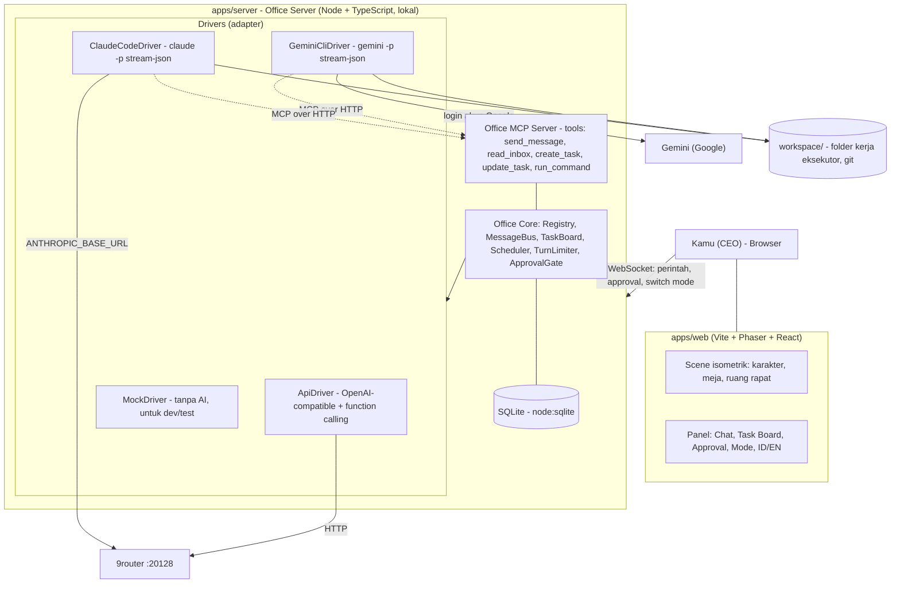
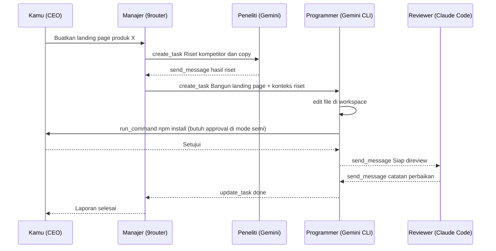
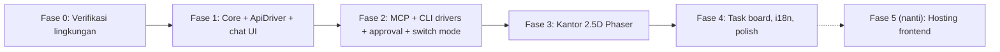
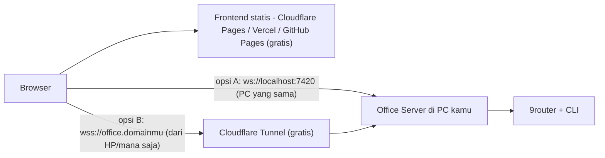

# Rancangan: AI Office — Kantor Virtual 2.5D dengan Karyawan AI Multi-Model

## Tujuan

Membangun **kantor virtual 2.5D isometrik** yang berjalan di browser. Setiap "karyawan" di kantor ini adalah AI dari model berbeda (Gemini, Claude, GLM, dll.). Kamu berperan sebagai **CEO** dan bisa:
- **DM** satu karyawan, **broadcast** ke semua, atau cukup memberi perintah ke **Manajer**, lalu Manajer membagi tugas.
- Melihat karyawan **berjalan, mengetik, rapat, dan menunggu persetujuan** secara realtime.
- Mengganti mode **Semi-otonom ↔ Otonom penuh** dengan satu tombol.
- Mengganti bahasa UI dan percakapan agent **ID ↔ EN**.

**Tanpa API key berbayar.** Semua model diakses lewat:
1. **9router** (`localhost:20128/v1`, endpoint yang kompatibel dengan OpenAI), yang sudah terpasang di PC kamu, dan
2. **CLI resmi** yang login dengan akun/langganan: **Gemini CLI** (akun Google) dan **Claude Code CLI** (sudah terpasang, v2.1.319), yang diarahkan ke 9router.

### Hasil keputusan sesi grill-me

| # | Keputusan | Pilihan |
|---|---|---|
| 1 | Sumber model | Akun Google / Google AI Pro, 9router, 3 akun Gemini Pro |
| 2 | Jenis kantor | **Hybrid**: agent "kantor" lewat 9router + agent "eksekutor" lewat CLI |
| 3 | Visual | **2.5D isometrik (Phaser.js)** |
| 4 | Struktur | **Hierarki**: CEO → Manajer → staf, plus DM langsung/broadcast |
| 5 | Otonomi | **Tombol switch** Semi-otonom ↔ Otonom penuh |
| 6 | Platform | **Web lokal** dulu; nanti frontend di-hosting gratis (GitHub/Vercel/Cloudflare) |
| 7 | Roster MVP | 5 karyawan: Manajer, Peneliti, Penulis, Programmer (Gemini CLI), Reviewer (Claude Code) |
| 8 | Bahasa | **Toggle ID/EN** di UI |
| 9 | Aset | **CC0 (Kenney.nl)**, bisa diganti nanti |

---

## Perlu Ditinjau

> [!IMPORTANT]
> **Claude Desktop (app chat) TIDAK dipakai.** App itu tidak punya API. Mengotomatisasi GUI-nya rapuh dan melanggar ToS. Sebagai gantinya kita menjalankan **CLI resmi** (`claude -p`, `gemini -p`) sebagai subprocess. Ini cara scripting yang didokumentasikan resmi oleh masing-masing vendor.

> [!WARNING]
> **Risiko ToS yang perlu kamu ketahui:**
> - Anthropic melarang token login langganan (OAuth) Claude dipakai oleh aplikasi pihak ketiga. Kalau 9router memakai langganan Claude kamu lewat OAuth, risikonya (throttle/suspend akun) ada di sisi akun kamu. Desain kita **tidak pernah mengambil token** apa pun. Kita hanya memanggil CLI resmi dan endpoint 9router.
> - Merotasi **3 akun Gemini** untuk mengakali kuota kemungkinan melanggar ToS Google. Rekomendasi saya: **1 akun untuk Gemini CLI**, akun lain hanya dipakai lewat 9router sesuai kebijakan masing-masing.

> [!WARNING]
> **Hosting ke Vercel/Cloudflare/GitHub Pages hanya untuk frontend.** Backend ("Office Server") **wajib tetap berjalan di PC kamu**, karena harus menjalankan CLI dan mengakses 9router di `localhost`. Serverless di Vercel/Cloudflare tidak bisa melakukan itu. Detailnya ada di bagian Rencana Hosting.

---

## Pertanyaan Terbuka

> [!IMPORTANT]
> 1. **Model apa saja yang tersedia di 9router?** (Nama/ID model untuk Manajer, Peneliti, Penulis.) Akan saya cek otomatis di Fase 0 lewat `GET /v1/models` setelah 9router dijalankan.
> 2. **Apakah 9router menyediakan endpoint Anthropic-compatible** (`/v1/messages`) untuk Claude Code? Akan diverifikasi di Fase 0. **Fallback:** Reviewer diganti menjadi agent API biasa lewat 9router, atau Gemini CLI kedua.
> 3. **Nama kantor/proyek?** Default: `ai-office`, di folder `C:\Users\Muhayara\.gemini\antigravity\scratch\ai-office`.

---

## Arsitektur



### Ide kunci: satu set "tools kantor" untuk semua jenis agent

- **Agent API** (Manajer, Peneliti, Penulis) memakai tools kantor lewat **function calling** di 9router.
- **Agent CLI** (Programmer, Reviewer) memakai tools kantor yang **sama persis** lewat **Office MCP Server**. Gemini CLI dan Claude Code sama-sama mendukung MCP.
- Implementasinya hanya satu (`office-tools.ts`), jadi semua agent bisa saling kirim pesan dan tugas tanpa peduli dari vendor mana modelnya.

### Alur contoh: "Buatkan landing page produk X"



### Mesin status karyawan → animasi

| Status | Pemicu | Animasi |
|---|---|---|
| `idle` | Tidak ada tugas | Duduk santai / jalan ke pantry |
| `thinking` | Driver mulai, belum ada output | Balon "…" |
| `working` | Output/tool call mengalir | Mengetik di meja |
| `messaging` | `send_message` | Jalan ke meja penerima + balon chat |
| `meeting` | Broadcast / rapat Manajer | Jalan ke ruang rapat |
| `waiting_approval` | Approval gate | Ikon ❗ + bunyi |
| `error` / `offline` | Gagal / kuota habis | Ikon ⚠ / kursi kosong |

### Switch Semi-otonom ↔ Otonom penuh

| Aspek | Semi-otonom | Otonom penuh |
|---|---|---|
| Edit file di `workspace/` | Boleh (ada git untuk rollback) | Boleh |
| Perintah terminal | **Harus approval** lewat `run_command` | Langsung jalan |
| Claude Code | `--permission-prompt-tool mcp__office__approval_prompt` | `--permission-mode bypassPermissions` |
| Gemini CLI | `--approval-mode auto_edit`, shell bawaan dimatikan, wajib pakai `office.run_command` | `--approval-mode yolo` |
| Batas giliran per tugas | 20 | 60 |
| Tombol darurat "⏸ Pause Semua" | Selalu aktif | Selalu aktif |

**Pengaman yang aktif di kedua mode:** batas giliran, deteksi ping-pong (dua agent saling balas lebih dari 6× tanpa progres), 1 proses per agent, penghitung pemakaian harian per agent, dan eksekutor dikunci di folder `workspace/`.

---

## Rencana Perubahan

Lokasi proyek: `C:\Users\Muhayara\.gemini\antigravity\scratch\ai-office` (monorepo npm workspaces, TypeScript penuh).

```
ai-office/
├─ package.json                 # npm workspaces + skrip dev/test/build
├─ office.config.yaml           # roster, model, posisi meja, persona
├─ .env.example                 # NINEROUTER_URL, NINEROUTER_KEY, OFFICE_TOKEN
├─ packages/shared/             # tipe & skema bersama (zod)
├─ apps/server/                 # Office Server
├─ apps/web/                    # Frontend Phaser + React
└─ workspace/                   # folder kerja eksekutor (git init)
```

---

### Komponen 1: `packages/shared` (kontrak data)

#### [NEW] `src/events.ts`
Protokol WebSocket server ↔ browser (satu sumber kebenaran untuk kedua sisi).
```ts
export type AgentStatus = 'idle'|'thinking'|'working'|'messaging'|'meeting'|'waiting_approval'|'error'|'offline';

export type ServerEvent =
  | { type: 'agent.status'; agentId: string; status: AgentStatus; detail?: string }
  | { type: 'message.created'; message: OfficeMessage }
  | { type: 'task.updated'; task: Task }
  | { type: 'approval.requested'; approval: ApprovalRequest }
  | { type: 'approval.resolved'; id: string; approved: boolean }
  | { type: 'office.mode'; mode: 'semi' | 'full' }
  | { type: 'usage.updated'; agentId: string; requestsToday: number };

export type ClientCommand =
  | { type: 'ceo.send'; to: string | 'all' | 'manager'; text: string }
  | { type: 'approval.respond'; id: string; approved: boolean }
  | { type: 'office.setMode'; mode: 'semi' | 'full' }
  | { type: 'office.pauseAll' } | { type: 'office.resumeAll' }
  | { type: 'office.setLanguage'; lang: 'id' | 'en' };
```

#### [NEW] `src/config.ts`
Skema zod untuk `office.config.yaml` (divalidasi saat startup, dengan pesan error yang jelas).

---

### Komponen 2: `apps/server`: Office Core

#### [NEW] `office.config.yaml` (di root)
```yaml
office: { name: "AI Office", language: id, mode: semi }
gateway: { baseUrl: "http://localhost:20128/v1", apiKeyEnv: NINEROUTER_KEY }
agents:
  - id: manager
    name: "Raka"
    role: manager
    driver: api
    model: "<model-terkuat-di-9router>"   # diisi setelah Fase 0
    desk: [4, 2]
    persona: "Manajer proyek. Pecah perintah CEO jadi tugas, delegasikan, rangkum hasil."
  - { id: researcher, name: "Sari",  role: researcher, driver: api, model: "<gemini-via-9router>", desk: [7, 2] }
  - { id: writer,     name: "Dimas", role: writer,     driver: api, model: "<model-murah/gratis>", desk: [7, 5] }
  - { id: coder,      name: "Bima",  role: executor,   driver: gemini-cli, model: "<gemini-pro>", desk: [2, 6] }
  - { id: reviewer,   name: "Laras", role: executor,   driver: claude-code, model: "<model-via-9router>", desk: [4, 6] }
```

#### [NEW] `src/core/message-bus.ts`
Pesan disimpan di SQLite, lalu event dipancarkan ke Scheduler dan WebSocket. Mendukung tujuan `agentId`, `all`, `manager`, dan `ceo`.

#### [NEW] `src/core/task-board.ts`
CRUD tugas: `todo → in_progress → review → done/blocked`, dengan `assignee`, `createdBy`, `parentTaskId`.

#### [NEW] `src/core/scheduler.ts`
Membangunkan agent yang punya inbox belum dibaca dan sedang tidak sibuk. Menegakkan aturan 1 proses per agent, `TurnLimiter`, deteksi ping-pong, dan `pauseAll`.

#### [NEW] `src/core/approval-gate.ts`
`request(agentId, action) → Promise<boolean>`. Di mode `full` langsung `true`. Di mode `semi`, permintaan dikirim ke UI dan menunggu jawaban CEO (timeout bisa diatur, default ditolak).

#### [NEW] `src/core/office-tools.ts`
Implementasi tunggal tools kantor yang dipakai oleh `ApiDriver` dan Office MCP Server:
```ts
export const officeTools = {
  send_message:  { input: z.object({ to: z.string(), text: z.string() }), run: (ctx, a) => bus.send(ctx.agentId, a.to, a.text) },
  read_inbox:    { input: z.object({}), run: (ctx) => bus.unread(ctx.agentId) },
  create_task:   { input: z.object({ title: z.string(), assignee: z.string(), details: z.string() }), run: ... },
  update_task:   { input: z.object({ taskId: z.string(), status: TaskStatus, note: z.string().optional() }), run: ... },
  list_team:     { input: z.object({}), run: () => registry.publicRoster() },
  run_command:   { input: z.object({ command: z.string() }), run: async (ctx, a) =>
                    (await approvals.request(ctx.agentId, a)) ? sandboxExec(a.command) : 'DITOLAK oleh CEO' },
  approval_prompt: { /* dipakai Claude Code --permission-prompt-tool */ },
};
```

#### [NEW] `src/core/prompts.ts`
System prompt per peran, ditambah aturan kantor (wajib pakai tools, bahasa ID/EN sesuai toggle, ringkas). Daftar tim disuntikkan otomatis dari roster.

#### [NEW] `src/db.ts`
Memakai `node:sqlite` (bawaan Node 25, tanpa kompilasi native di Windows). Tabel: `messages`, `tasks`, `agent_sessions`, `approvals`, `usage`.

---

### Komponen 3: `apps/server`: Drivers

#### [NEW] `src/drivers/types.ts`
```ts
export interface AgentDriver {
  run(input: { agent: AgentConfig; prompt: string; sessionId?: string; mode: 'semi'|'full'; signal: AbortSignal },
      onEvent: (e: DriverEvent) => void): Promise<{ sessionId?: string; finalText: string }>;
}
export type DriverEvent = { kind: 'thinking' } | { kind: 'text'; delta: string }
  | { kind: 'tool'; name: string; args: unknown } | { kind: 'error'; message: string };
```

#### [NEW] `src/drivers/api-driver.ts`
Client OpenAI-compatible ke 9router (`fetch` + SSE streaming). Loop function calling memakai `officeTools`, maksimal N langkah per giliran. Riwayat percakapan diambil dari SQLite dan diringkas otomatis kalau terlalu panjang.

#### [NEW] `src/drivers/gemini-cli-driver.ts`
```ts
spawn('gemini', ['-p', prompt, '--output-format', 'stream-json', '-m', agent.model,
  '--approval-mode', mode === 'full' ? 'yolo' : 'auto_edit'], { cwd: WORKSPACE })
```
MCP kantor didaftarkan lewat `workspace/.gemini/settings.json` (`mcpServers.office.httpUrl` + timeout panjang supaya approval bisa ditunggu). Parser JSONL diubah menjadi `DriverEvent`.

#### [NEW] `src/drivers/claude-code-driver.ts`
```ts
spawn('claude', ['-p', prompt, '--output-format', 'stream-json', '--verbose',
  '--mcp-config', MCP_JSON, '--model', agent.model,
  ...(sessionId ? ['--resume', sessionId] : []),
  ...(mode === 'full' ? ['--permission-mode', 'bypassPermissions']
                      : ['--permission-prompt-tool', 'mcp__office__approval_prompt'])],
  { cwd: WORKSPACE, env: { ...process.env, ANTHROPIC_BASE_URL: NINEROUTER_ANTHROPIC_URL, ANTHROPIC_AUTH_TOKEN: KEY } })
```

#### [NEW] `src/drivers/mock-driver.ts`
Agent palsu dengan balasan dan delay yang bisa diprediksi. Dipakai untuk mengembangkan UI dan menjalankan test **tanpa memakai kuota sama sekali**.

---

### Komponen 4: `apps/server`: Transport

#### [NEW] `src/mcp-server.ts`
`@modelcontextprotocol/sdk` dengan Streamable HTTP di `http://127.0.0.1:7421/mcp`. Identitas agent dibawa lewat header/query (`?agent=coder`).

#### [NEW] `src/http.ts`
Fastify + `@fastify/websocket` di `127.0.0.1:7420`. Fungsinya: `/ws` (event + command, dilindungi `OFFICE_TOKEN`), `/api/state` (snapshot awal), `/health`.

#### [NEW] `src/index.ts`
Bootstrap: load config → DB → registry → drivers → scheduler → HTTP + MCP. Saat startup juga mengecek kesehatan 9router, `gemini`, dan `claude`. Agent yang dependensinya tidak tersedia ditandai `offline` dengan alasan yang jelas.

---

### Komponen 5: `apps/web` (Frontend 2.5D)

#### [NEW] `src/game/iso.ts`
Proyeksi isometrik (grid ↔ layar) dan depth sorting berdasarkan `y`.

#### [NEW] `src/game/OfficeScene.ts`
Phaser 3: lantai, dinding, meja per agent, ruang rapat, pantry. Pathfinding pakai `easystarjs`. Karakter memutar animasi sesuai `AgentStatus`, menampilkan balon chat dan ikon status. **Klik karakter untuk membuka DM.**

#### [NEW] `src/game/AgentSprite.ts`
State machine animasi dan antrian gerakan (jalan → aksi → kembali ke meja).

#### [NEW] `src/ui/*` (React overlay)
- `ChatPanel`: tab **Semua / Manajer / per-agent (DM)**, input dengan pemilih tujuan.
- `TaskBoard`: kanban mini realtime.
- `ApprovalModal`: detail perintah, tombol **Setujui / Tolak**, bunyi notifikasi.
- `TopBar`: switch **Semi ↔ Otonom**, **⏸ Pause Semua**, toggle **ID/EN**, pemakaian per agent hari ini.

#### [NEW] `src/i18n/{id,en}.json` + `useT()`
Toggle bahasa sekaligus mengirim `office.setLanguage`, supaya agent juga ikut berganti bahasa.

#### [NEW] `src/net/socket.ts` + `src/store.ts`
Client WebSocket dengan auto-reconnect, plus store Zustand. URL server bisa diatur (`VITE_OFFICE_URL`), sebagai persiapan hosting.

#### [NEW] `public/assets/`
Aset Kenney CC0 (furnitur isometrik) + karakter sederhana. Disertakan juga `CREDITS.md`.

---

## Fase Pengerjaan



| Fase | Isi | Hasil yang bisa dicoba |
|---|---|---|
| **0** | Jalankan 9router dan catat model; pasang Gemini CLI (`npm i -g @google/gemini-cli`) lalu login; tes `claude -p` lewat 9router; rekam contoh output stream-json sebagai fixture test | Laporan kompatibilitas + roster final |
| **1** | Monorepo, shared types, DB, MessageBus, TaskBoard, Scheduler, ApiDriver, MockDriver, WebSocket, UI chat sederhana | Chat dengan Manajer, broadcast, Manajer mendelegasikan ke Peneliti/Penulis |
| **2** | Office MCP Server, GeminiCliDriver, ClaudeCodeDriver, ApprovalGate, switch mode, Pause Semua | Programmer & Reviewer benar-benar mengedit `workspace/`, approval muncul di UI |
| **3** | Scene isometrik, sprite, pathfinding, balon chat, klik untuk DM | Kantor hidup dan sinkron dengan aktivitas agent |
| **4** | TaskBoard UI, i18n ID/EN, statistik pemakaian, suara, polish | MVP lengkap |
| **5** | Hosting frontend (lihat bawah) | Akses dari URL publik |

---

## Rencana Hosting (Fase 5)



- **Opsi A:** frontend online, server lokal. Chrome akan meminta izin "akses jaringan lokal" satu kali.
- **Opsi B:** `cloudflared` tunnel, ditambah `OFFICE_TOKEN` dan opsional Cloudflare Access. Office Server tetap hanya bind ke `127.0.0.1`.
- Saat PC mati, kantor ikut "tutup". Ini konsekuensi dari tidak memakai API key berbayar.

---

## Rencana Verifikasi

### Test Otomatis (Vitest)
```powershell
npm run typecheck      # tsc --noEmit untuk semua workspace
npm test               # vitest run
npm run build          # build server + web
```
Cakupan test:
- `message-bus.test.ts`: routing ke agent, `all`, `manager`, `ceo`, serta persistensi.
- `scheduler.test.ts`: 1 proses per agent, batas giliran, deteksi ping-pong, pause/resume.
- `approval-gate.test.ts`: mode `full` auto-approve, mode `semi` menunggu dan default-tolak saat timeout.
- `gemini-parser.test.ts` / `claude-parser.test.ts`: parsing fixture stream-json asli dari Fase 0.
- `office-flow.e2e.test.ts`: skenario CEO → Manajer → delegasi → selesai, memakai **MockDriver** (tanpa kuota).
- `api-driver.test.ts`: loop function calling terhadap server OpenAI-compatible palsu.

### Verifikasi Manual
1. `npm run dev` lalu buka `http://localhost:5173`. Kantor tampil dengan 5 karakter di meja masing-masing.
2. Ketik ke **Manajer**: "Buat file `hello.html` berisi landing page sederhana". Karakter harus berjalan dan mengetik, task board terisi, dan file benar-benar muncul di `workspace/`.
3. Di mode **Semi**, perintah terminal memunculkan popup approval. Coba **Tolak**, agent harus menerima "DITOLAK".
4. Ganti ke **Otonom penuh**, ulangi. Kali ini tanpa popup.
5. Klik **⏸ Pause Semua**. Semua proses berhenti dan karakter kembali `idle`.
6. Toggle **EN**. UI dan balasan agent berikutnya harus dalam bahasa Inggris.
7. Matikan 9router. Agent API harus berstatus `offline` dengan pesan yang jelas, dan aplikasi tidak crash.
