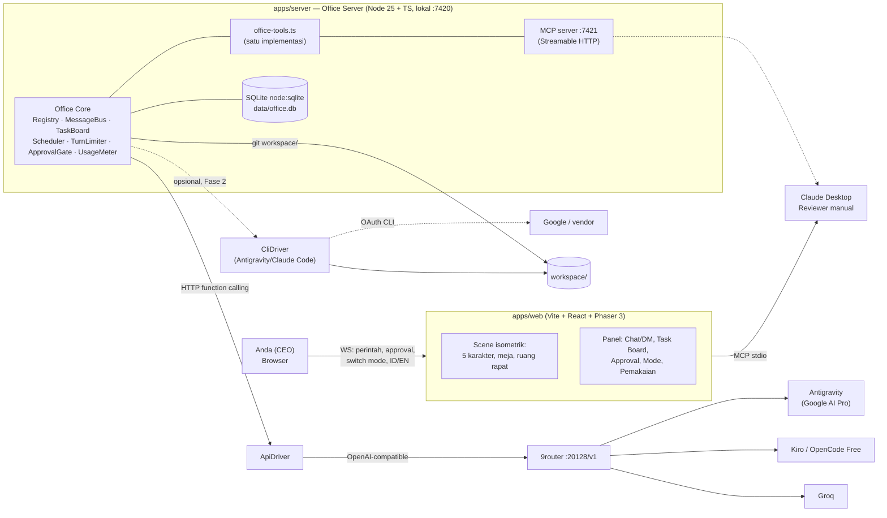
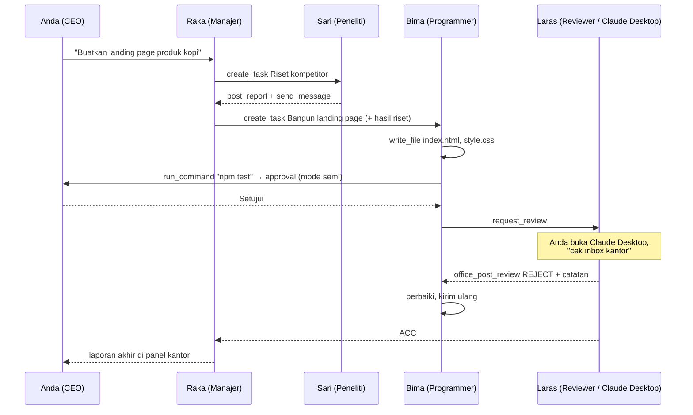

# Master Plan v3 — Office Agents

**Kantor virtual 2.5D isometrik berisi 5 karyawan AI dari vendor berbeda, dikendalikan oleh Anda sebagai CEO.**

Dokumen ini **menggantikan** tiga rancangan sebelumnya di folder ini (Sonnet, Gemini Argon, Opus/Antigravity) dan memakai fakta hasil audit langsung terhadap PC Anda, bukan asumsi. Status: **rencana final, belum ada kode yang ditulis.**

Tanggal: 10 November 2026 · Target biaya: **$0/bulan** · Platform: Windows, web lokal.

---

## 0. Keputusan Final

| # | Aspek | Putusan | Alasan |
|---|---|---|---|
| 1 | Gateway model | **9router** `http://127.0.0.1:20128/v1` | Sudah terpasang, 8 koneksi provider aktif, riwayat pemakaian nyata |
| 2 | Visual | **Phaser 3, isometrik 2.5D, aset Kenney CC0** | Paling cepat terlihat hidup; A* dan tile sudah matang |
| 3 | Roster | **5 kursi**: Manajer, Peneliti, Penulis, Programmer, Reviewer | Sesuai keputusan Anda; kuota free tier masih cukup |
| 4 | Claude | **Claude Desktop (akun gratis) + MCP, manual** | Tanpa langganan Pro, Claude Code CLI tidak bisa dipakai; otomasi web melanggar ToS |
| 5 | Arsitektur | **Hybrid**: agent API lewat 9router; kursi CLI menyusul bila terverifikasi | Realistis: CLI sekarang tidak tersedia |
| 6 | Otonomi | Tombol **Semi-otonom ↔ Otonom penuh** | Anda tetap punya kendali atas perintah terminal |
| 7 | Bahasa | Toggle **ID / EN** (UI + balasan agent) | Permintaan Anda |
| 8 | Hosting | Web **lokal** dulu; hosting frontend nanti (Fase 5) | Backend wajib di PC karena memanggil 9router lokal |
| 9 | Akun Google | 2–3 akun AI Pro ditambahkan sebagai koneksi Antigravity di 9router | Menambah kuota; risiko ToS dicatat di §11 |

---

## 1. Fakta Lapangan (hasil audit mesin, 10 Nov 2026)

| Temuan | Bukti | Konsekuensi |
|---|---|---|
| Node **v25.9.0**, npm 11.12, Python 3.11.9, git 2.53, Chrome terpasang | probe runtime | Stack Node/TypeScript murni; `node:sqlite` bawaan sudah diuji jalan → **tanpa modul native** |
| **9router 0.5.112** terpasang, server sedang **mati** | `~/.9router` + DB `data.sqlite` | Fase 0 wajib menyalakan `9router -t` |
| Koneksi provider: **Antigravity** (OAuth), **Gemini API key ×2**, **Groq**, **Kilo Code**, **Kiro ×2**, **OpenRouter** (nonaktif) | tabel `providerConnections` | 4–6 sumber model gratis siap dipakai |
| Riwayat: 221 request, sukses, terakhir 5 Nov 2026 (75 request) | tabel `usageHistory` | Gateway terbukti pernah bekerja; token OAuth provider mungkin perlu diperbarui |
| **Claude Code CLI 2.1.319** terpasang, akun tercatat `claude_pro` | `claude --version`, `claude auth status` | **Token OAuth kedaluwarsa → `401`.** Tanpa langganan aktif, CLI tidak bisa dipakai |
| **Claude Desktop** terpasang + `claude_desktop_config.json` berisi server `filesystem` | file config | Jalur Claude satu-satunya: **MCP manual** |
| **Antigravity app 2.30.0** terpasang; `agy-node.cmd` = shim Electron-as-Node, **bukan** agent CLI | `%APPDATA%\Antigravity\bin` | Antigravity CLI **belum terpasang**; diverifikasi di Fase 0 |
| Gemini CLI **tidak terpasang**; paket npm `@google/gemini-cli@0.67.0` masih ada | `Get-Command`, npm view | Layanan free tier dilaporkan dimatikan 18 Jun 2026 → jangan diandalkan |
| Ekstensi **Cline** sudah dikonfigurasi ke 9router (`ultra-combo-v2`), tapi binary `cline` tidak ada | `9router show`, `~/.cline` | Opsional untuk driver CLI nanti |
| Tidak ada Ollama / model lokal; browser Playwright tersedia | probe | Tidak ada fallback offline; fokus API + Claude manual |
| npm registry OK, tapi cache default di profil user → EPERM di sandbox | uji `npm view` | Proyek memakai `.npmrc` dengan cache lokal |

---

## 2. Yang Realistis dan Yang Tidak

**Bisa dilakukan sekarang**
- 4 kursi API (Manajer, Peneliti, Penulis, Programmer) dijalankan lewat 9router dengan satu adapter OpenAI-compatible.
- 1 kursi Reviewer memakai Claude Desktop gratis lewat **MCP** — Anda membukanya dan memeriksa hasil kerja.
- Semua agent memakai **satu set tool kantor** yang sama (pesan, tugas, laporan, file, terminal ber-approval), jadi model dari vendor mana pun bisa saling oper tugas.
- Kantor 2.5D yang bergerak berdasarkan event nyata, bukan animasi palsu.

**Tidak dilakukan (dan alasannya)**
- ❌ Otomasi `claude.ai` / `chatgpt.com` lewat browser, cookie, atau CDP — melanggar Anthropic Consumer ToS §3(7), sanksi pemutusan akun, tanpa banding.
- ❌ `claude -p` sebagai karyawan otomatis — butuh langganan Pro/Max yang aktif.
- ❌ Gemini CLI sebagai eksekutor — layanan free tier-nya diberhentikan; penggantinya Antigravity CLI yang belum terpasang.
- ❌ Merotasi 3 akun Google untuk mengakali kuota secara agresif — berisiko; hanya dipakai sebagai penambah kapasitas normal, bukan pengakal.

**Hybrid tetap jadi arsitektur, tetapi jujur:** v1 = semua agent **API driver**; **CLI driver** disediakan sebagai antarmuka di Fase 2 dan baru diaktifkan bila Fase 0 membuktikan Antigravity CLI bisa headless + MCP. Tidak ada kursi yang bergantung pada sesuatu yang belum terbukti.

---

## 3. Arsitektur



**Prinsip**
1. **Orkestrasi, bukan telepati.** Model tidak saling bicara; semua lewat `MessageBus` + `TaskBoard` yang kita kendalikan.
2. **Satu implementasi tool** (`office-tools.ts`) dipakai dua jalur: function-calling untuk agent API, dan MCP untuk Claude Desktop / CLI. Inilah yang membuat "AI berbeda bisa saling terhubung".
3. **Database tunggal penulis.** Hanya Office Core yang menulis SQLite; UI, MCP, dan driver membaca lewat API. Tidak ada lock contention.
4. **Event = sumber kebenaran visual.** Renderer hanya menampilkan event; tidak ada logika bisnis di frontend.
5. **Idle gratis.** Agent hanya memanggil model bila ada pesan/tugas. Kantor yang diam tidak menghabiskan kuota.

---

## 4. Kontrak Data & Protokol

### 4.1 Event WebSocket (server → browser)

```ts
type AgentStatus = 'idle'|'thinking'|'working'|'messaging'|'meeting'
                 |'waiting_approval'|'error'|'offline';

type ServerEvent =
  | { type:'state.snapshot'; agents:AgentView[]; tasks:Task[]; approvals:Approval[]; mode:Mode; lang:Lang }
  | { type:'agent.status'; agentId:string; status:AgentStatus; detail?:string }
  | { type:'agent.say'; agentId:string; text:string; to?:string }
  | { type:'message.created'; message:Message }
  | { type:'task.updated'; task:Task }
  | { type:'approval.requested'; approval:Approval }
  | { type:'approval.resolved'; id:string; approved:boolean }
  | { type:'usage.updated'; agentId:string; requestsToday:number; cap:number }
  | { type:'office.mode'; mode:'semi'|'full' }
  | { type:'office.paused'; paused:boolean }
  | { type:'office.language'; lang:'id'|'en' }
  | { type:'run.started'|'run.finished'; agentId:string; runId:string };
```

### 4.2 Perintah klien (browser → server)

```ts
type ClientCommand =
  | { type:'ceo.send'; to:'manager'|'all'|string; text:string }
  | { type:'approval.respond'; id:string; approved:boolean }
  | { type:'office.setMode'; mode:'semi'|'full' }
  | { type:'office.pauseAll'; paused:boolean }
  | { type:'office.setLanguage'; lang:'id'|'en' }
  | { type:'office.stopAgent'; agentId:string };
```

### 4.3 Tool kantor (dipakai function-calling **dan** MCP)

| Tool | Fungsi |
|---|---|
| `send_message(to, text)` | Kirim pesan ke agent lain / `ceo` / `all` |
| `read_inbox()` | Baca pesan belum dibaca (ditandai terbaca) |
| `list_team()` | Roster + status + tugas aktif |
| `create_task(title, assignee, details, parentId?)` | Buat tugas anak |
| `claim_task(taskId)` | Ambil tugas `todo` |
| `update_task(taskId, status, note?)` | `in_progress / review / done / blocked` |
| `list_tasks(status?)` | Lihat papan tugas |
| `post_report(taskId, summary, files?)` | Laporan hasil kerja |
| `request_review(taskId, to)` | Minta review |
| `ask_human(question)` | Eskalasi ke CEO |
| `write_file(path, content)` | Tulis file di `workspace/` (sandbox) |
| `read_file(path)` / `list_files(dir?)` | Baca file workspace |
| `run_command(command)` | Terminal — **butuh approval** di mode semi |
| `finish(note?)` | Akhiri giliran |

Claude Desktop mendapat subset berprefiks `office_`: `office_overview`, `office_read_inbox`, `office_send_message`, `office_list_tasks`, `office_get_task`, `office_get_diff`, `office_post_review`.

### 4.4 Skema SQLite

```sql
agents(id PK, name, role, persona, color, desk_x, desk_y, status, created_at)
seats(id PK, agent_id, driver, model, fallbacks_json, daily_cap, req_today, reset_at)
messages(id PK, thread_id, sender, recipient, kind, body, created_at, read_at)
tasks(id PK, parent_id, title, details, assignee, reviewer, status,
      created_by, created_at, updated_at)
   -- status: todo|in_progress|review|done|blocked
runs(id PK, agent_id, task_id, driver, model, status, started_at, ended_at, error)
steps(id PK, run_id, seq, kind, name, input_json, output_json, created_at)
approvals(id PK, agent_id, kind, payload_json, status, created_at, decided_at)
usage(agent_id, day, model, requests, tokens_in, tokens_out)
events(id PK, ts, kind, agent_id, payload_json)   -- replay & visual
kv(key PK, value)                                  -- mode, bahasa, pause, dsb.
```

### 4.5 Konfigurasi `office.config.json`

```jsonc
{
  "office": { "name": "Office Agents", "language": "id", "mode": "semi" },
  "gateway": { "baseUrl": "http://127.0.0.1:20128/v1", "apiKeyEnv": "NINEROUTER_KEY" },
  "limits": { "maxStepsPerTurn": 8, "maxTurnsPerTask": 20,
              "pingPongLimit": 6, "turnTimeoutMs": 180000 },
  "agents": [
    { "id":"manager", "name":"Raka",  "role":"manager",   "desk":[6,3],
      "driver":"api", "model":"ag/gemini-3.8-flash-high",
      "fallbacks":["groq/openai/gpt-oss-120b"], "dailyCap":80 },
    { "id":"researcher","name":"Sari", "role":"researcher","desk":[10,3],
      "driver":"api", "model":"ag/gemini-3.8-flash-medium",
      "fallbacks":["oc/glm-5.3-flash-free"], "dailyCap":80 },
    { "id":"writer",    "name":"Dimas","role":"writer",    "desk":[10,7],
      "driver":"api", "model":"oc/glm-5.3-flash-free",
      "fallbacks":["groq/openai/gpt-oss-120b"], "dailyCap":120 },
    { "id":"coder",     "name":"Bima", "role":"executor",  "desk":[6,7],
      "driver":"api", "model":"oc/deepseek-v4.1-flash-free",
      "fallbacks":["ag/claude-sonnet-4-6","kr/claude-sonnet-4.5-thinking-agentic"],
      "dailyCap":80, "escalationCap":3 },
    { "id":"reviewer",  "name":"Laras","role":"reviewer",  "desk":[3,5],
      "driver":"manual", "channel":"claude-desktop", "model":"claude-sonnet" }
  ]
}
```

> Model ID di atas adalah **seed** dari basis data 9router Anda. Fase 0 menggantinya dengan ID yang terbukti hidup.

---

## 5. Lima Karyawan v1

| Kursi | Peran | Driver | Model awal | Tugas utama | Batas/hari |
|---|---|---|---|---|---|
| **Raka** | Manajer | API | `ag/gemini-3.8-flash-high` | Pecah perintah CEO, delegasi, rangkum laporan | 80 |
| **Sari** | Peneliti | API | `ag/gemini-3.8-flash-medium` | Riset, kumpulkan konteks, catatan fakta | 80 |
| **Dimas** | Penulis | API | `oc/glm-5.3-flash-free` | Dokumen, copy, README, laporan | 120 |
| **Bima** | Programmer | API (→CLI di Fase 2) | `oc/deepseek-v4.1-flash-free` | Menulis/mengedit kode di `workspace/` | 80 + 3 eskalasi |
| **Laras** | Reviewer | **Manual** (Claude Desktop) | Claude Sonnet di app gratis | Review diff, ACC/REJECT, catatan | manual |

**Aturan eskalasi:** gagal 2× atau ditolak review → naik ke model lebih kuat (`ag/claude-*`, `kr/claude-sonnet-4.5`) maksimal **3 request/hari**, karena kredit Kiro hanya ~50/bulan.

**Mengapa Claude manual:** dengan akun gratis, satu-satunya jalur yang sah adalah app Desktop + MCP. Anda membuka Claude, meminta "cek inbox kantor", Claude memanggil `office_read_inbox`, membaca diff, lalu `office_post_review`. Agent lain tetap berjalan; tugas review hanya menunggu.

---

## 6. Driver

```ts
interface AgentDriver {
  run(input:{ agent:AgentConfig; prompt:string; context:TurnContext;
              mode:Mode; signal:AbortSignal },
      onEvent:(e:DriverEvent)=>void
  ): Promise<{ finalText:string; steps:Step[] }>;
}
type DriverEvent = {kind:'thinking'} | {kind:'text'; delta:string}
                 | {kind:'tool'; name:string; input:unknown}
                 | {kind:'status'; status:AgentStatus} | {kind:'error'; message:string};
```

- **ApiDriver** — `POST {baseUrl}/chat/completions` (stream SSE), kirim `tools` dari office-tools. Loop: model minta tool → eksekusi → kirim hasil → ulangi maks 8 langkah. Bila model tidak mendukung function calling (atau balas teks JSON), pakai **mode envelope**: parse `{say, actions:[...]}`, validasi zod, satu kali repair bila invalid.
- **MockDriver** — balasan skrip, tanpa kuota. Dipakai seluruh test dan pengembangan UI.
- **CliDriver** (Fase 2, opsional) — `spawn` CLI resmi di `workspace/` dengan MCP kantor; hanya diaktifkan bila Fase 0 lolos. Struktur sudah disiapkan agar tidak ada penulisan ulang.

**Disiplin konteks (hemat kuota):** system prompt peran ≤ 400 token; roster disuntik ringkas; maks 6 pesan terakhir; riwayat panjang diringkas lewat model termurah, bukan model utama.

---

## 7. Alur End-to-End (contoh)



---

## 8. Semi-Otonom ↔ Otonom Penuh

| Aspek | Semi-otonom (default) | Otonom penuh |
|---|---|---|
| Tulis file di `workspace/` | Boleh (git untuk rollback) | Boleh |
| `run_command` | **Approval CEO** di UI | Langsung jalan (allowlist) |
| Batas giliran per tugas | 20 | 60 |
| Batas langkah per giliran | 8 | 12 |
| Pause Semua | Selalu aktif | Selalu aktif |
| Notifikasi suara | Saat approval | Saat selesai/gagal |

**ApprovalGate** mengirim `approval.requested` ke UI, menunggu jawaban maks 10 menit; timeout = **ditolak** (fail-safe). **Pause** menghentikan scheduler dan membatalkan proses berjalan (`AbortSignal`), status agent kembali `idle`.

---

## 9. Kegagalan & Degradasi

| Kondisi | Perilaku |
|---|---|
| 9router mati | Semua kursi API `offline` + banner "Gateway mati — jalankan `9router -t`"; aplikasi tidak crash; antrean tetap tersimpan |
| Provider 429 / kuota habis | Coba `fallbacks` berurutan → bila semua habis, agent `offline` dan tugas masuk antrean harian |
| Model menolak `tools` | Otomatis beralih ke mode envelope JSON untuk run itu (diingat per model) |
| Model balas JSON rusak | 1× repair prompt; masih gagal → tugas `blocked` + `ask_human` |
| Ping-pong antar-agent | Deteksi >6 balasan tanpa perubahan status → hentikan, `blocked`, tampilkan di UI |
| Claude Desktop tidak dibuka | Review tetap antre; badge di kursi Laras; tidak menahan agent lain |
| Server restart | Tugas & pesan dari SQLite; run yang menggantung ditandai `aborted` saat boot |
| WS putus | Klien auto-reconnect lalu minta `state.snapshot` |
| Output model sangat panjang | Dipotong di DB (8 KB/step), penuh ke `data/logs/` |

---

## 10. UI 2.5D (Phaser 3)

- **Proyeksi isometrik** ubin 64×32, peta 24×14; depth-sort `x+y`; kamera zoom + pan.
- **Zona**: 4 meja staf, 1 meja Reviewer (dekat jendela), meja CEO di depan, ruang rapat tengah, papan Kanban, papan pemakaian, pantry.
- **Karakter**: sprite 4 arah (Kenney CC0), animasi `idle / walk / type / meet / blocked`; status di atas kepala; klik → panel DM.
- **Balon chat** saat `agent.say` / `message.created`; indikator ❗ untuk approval.
- **HUD React**: `ChatPanel` (tab Semua / Manajer / per-agent), `TaskBoard` kanban mini, `ApprovalModal`, `TopBar` (mode, pause, ID/EN, pemakaian), `AgentList`.
- **i18n**: `id.json` / `en.json`; toggle mengubah UI **dan** instruksi bahasa pada prompt agent berikutnya.
- **Performa**: target 60 fps, <150 MB; sprite atlas, tanpa shader mahal; opsi `reduce-motion`.
- **Aset**: Kenney isometric (CC0) + `CREDITS.md`; dapat diganti tanpa mengubah kode.

---

## 11. Keamanan

- Semua file agent dikurung di `workspace/` (path traversal ditolak, ukuran tulis ≤256 KB).
- `run_command` hanya lewat ApprovalGate; allowlist perintah (`npm test`, `npm run build`, `git status/diff`, `node`, `python`); shell bebas ditolak.
- WebSocket dilindungi `OFFICE_TOKEN`; server bind `127.0.0.1` saja.
- Pesan antar-agent & hasil tool diperlakukan sebagai **data**, bukan instruksi (mitigasi prompt injection). Instruksi hanya dari CEO dan system prompt peran.
- Tidak ada API key provider di proyek ini; hanya URL 9router (+ key opsional) di `.env`.
- **Risiko 9router**: memakai OAuth Kiro/Antigravity di klien pihak ketiga bisa berujung pembatasan akun. Anda menerima risiko ini; desain dibuat agar bisa dilepas dengan mengganti `baseUrl`/driver saja.

---

## 12. Struktur Repo & Stack

```
P:\gemini-lab\office\
├─ package.json               # npm workspaces, skrip dev/test/build
├─ office.config.json         # roster, model, meja, persona, limit
├─ .env.example               # NINEROUTER_URL, NINEROUTER_KEY, OFFICE_TOKEN
├─ .npmrc                     # cache=./.npm-cache  (menghindari EPERM sandbox)
├─ packages/shared/           # tipe + skema zod (event, config, tool)
├─ apps/server/               # Office Core + driver + MCP (:7420, :7421)
│   └─ src/{core,drivers,db,http,mcp-server,prompts}.ts
├─ apps/web/                  # Vite + React + Phaser 3 (:5173)
│   └─ src/{game,ui,net,store,i18n}
├─ workspace/                 # folder kerja agent (git init, di-ignore)
├─ data/                      # office.db, logs (di-ignore)
└─ docs/f0-report.md, seat-matrix.md
```

**Versi terverifikasi di mesin Anda:** Node 25.9.0 · TypeScript 5.9.3 · React 19.3.1 · Vite 8.3.7 · Phaser 3.x · `@modelcontextprotocol/sdk` 1.32.2 · Hono 4.13 · ws 8.22 · zod 4.6. Cache npm lokal wajib (`.npmrc`).

**Skrip:** `npm run dev` (server + web) · `npm test` (Vitest + MockDriver, 0 kuota) · `npm run typecheck` · `npm run build` · `npm run mcp:build`.

---

## 13. Fase Pengerjaan

| Fase | Isi | Selesai bila |
|---|---|---|
| **F0 — Verifikasi (½ hari)** | Jalankan `9router -t`; `GET /v1/models`; uji 1 request per model kandidat + kemampuan tool-calling; cek Antigravity CLI; daftarkan MCP `office` ke Claude Desktop dan uji `office_overview` | `docs/f0-report.md` + `docs/seat-matrix.md` berisi model final, latensi, status tool-calling, dan keputusan Claude Desktop terbukti |
| **F1 — Core + chat (2 hari)** | Monorepo, shared types, SQLite, MessageBus, TaskBoard, Scheduler, ApiDriver, MockDriver, HTTP+WS, chat UI sederhana | Dari browser: kirim perintah ke Manajer; Manajer membuat ≥2 tugas; Peneliti/Penulis merespons; semua tampil di chat |
| **F2 — MCP + approval + mode (3 hari)** | office-tools → MCP server, Claude Desktop reviewer, ApprovalGate, switch semi/full, Pause, UsageMeter | Laras bisa membaca inbox dari Claude Desktop dan mengirim verdict; `run_command` memunculkan popup; tolak → agent menerima "DITOLAK" |
| **F3 — Kantor 2.5D (4–5 hari)** | Scene Phaser, sprite, A*, balon chat, klik DM, sinkron status | 5 karakter bergerak sesuai event nyata; tugas nyata berjalan sambil kantor hidup |
| **F4 — Polish (2 hari)** | Kanban, i18n ID/EN, statistik pemakaian, suara, tes lengkap, dokumentasi | Semua kriteria penerimaan §14 lulus |
| **F5 — Hosting (nanti)** | Frontend statis + tunnel bila perlu | Anda bisa membuka dari HP; server tetap di PC |

---

## 14. Verifikasi & Kriteria Penerimaan

**Otomatis (tanpa kuota, MockDriver):**
`message-bus.test.ts` (routing agent/all/manager/ceo) · `scheduler.test.ts` (1 proses per agent, turn limit, ping-pong, pause) · `approval-gate.test.ts` (full=auto, semi=menunggu, timeout=tolak) · `api-driver.test.ts` (loop function-calling ke server OpenAI palsu) · `parsers.test.ts` (fixture stream-json bila CLI dipakai) · `office-flow.e2e.test.ts` (CEO → Manajer → delegasi → selesai) · `pathfinding.test.ts` (A*).

**Manual (v1):**
1. `npm run dev` → kantor tampil, 5 karakter di meja.
2. Kirim "Buat file `hello.html` berisi landing page sederhana" ke Manajer → karakter bergerak, task board terisi, **file benar-benar muncul** di `workspace/`.
3. Mode semi → `run_command` memunculkan modal; tolak → agent menerima "DITOLAK".
4. Mode otonom → ulangi, tanpa modal.
5. ⏸ Pause Semua → semua proses berhenti, karakter `idle`.
6. Toggle EN → UI dan balasan berikutnya berbahasa Inggris.
7. Matikan 9router → agent API `offline` + pesan jelas, aplikasi tetap hidup.
8. Tutup Claude Desktop → review mengantre, badge muncul, agent lain tetap jalan.
9. **Kriteria inti:** satu perintah CEO menghasilkan rantai Manajer → Peneliti → Programmer → Reviewer tanpa intervensi di tengah, dengan bukti file nyata.

---

## 15. Risiko

| Risiko | Dampak | Mitigasi |
|---|---|---|
| 9router / provider mati | Agent berhenti | Banner, antrean, fallback, health check saat boot |
| Kuota free tier menipis (Kiro ~50 kredit/bulan) | Programmer lemah | Kerja harian di `oc/` gratis, eskalasi maks 3/hari |
| Gemini CLI mati, Antigravity CLI belum ada | Tidak ada eksekutor CLI | v1 pakai API driver; CLI hanya upgrade terverifikasi |
| Kualitas tool-calling model gratis | Tugas gagal/berputar | Mode envelope, repair, turn limit, review manual |
| Claude Desktop terbatas (akun gratis) | Review lambat | Kursi manual tidak menahan agent lain; badge antre |
| ToS 9router (OAuth pihak ketiga) | Akun dibatasi | Risiko diterima & terdokumentasi; driver bisa dilepas |
| UI membengkak | Fitur inti tertunda | Backend dulu (F1–F2), visual F3 |
| Prompt injection | Aksi tak diinginkan | Data-not-instruction + approval + allowlist |

---

## 16. Pertanyaan Terbuka (dijawab di F0, bukan diasumsikan)

1. Model mana yang benar-benar hidup di 9router setelah `9router -t`, dan mana yang mendukung tool-calling?
2. Apakah 9router masih bisa memakai koneksi Antigravity/Kiro (token OAuth bisa kedaluwarsa sejak 5 Nov)?
3. Apakah Antigravity CLI (`agy`) tersedia & bisa headless + MCP? Bila ya, Bima naik ke CLI di F2.
4. Apakah Claude Desktop gratis menerima server MCP stdio lokal di Windows? (Konfigurasi sudah ada; tinggal uji satu panggilan.)
5. Berapa akun Google AI Pro yang benar-benar aktif, dan apakah ditambahkan sebagai koneksi Antigravity terpisah?

---

## 17. Sumber

[Anthropic Consumer Terms](https://www.anthropic.com/legal/consumer-terms) · [9router](https://github.com/decolua/9router) · [MCP TypeScript SDK](https://github.com/modelcontextprotocol/typescript-sdk) · [OpenRouter limits](https://openrouter.ai/docs/api_reference/limits) · [Groq limits](https://console.groq.com/docs/rate-limits) · [Kenney isometric assets (CC0)](https://kenney.nl/assets/tag:isometric) · [Antigravity CLI reference](https://github.com/dicklesworthstone/agentic_coding_flywheel_setup/blob/6c95d50a435fbf0b898dbfbce3e10060d7a47a4b/docs/AGY_MIGRATION_REFERENCE.md) · Dokumen pendukung di folder ini: [riset](research-brief-ai-office.md), [blueprint Sonnet](Rancangan-Lengkap-Office-Agents-versi-sonnet-5.5.md), [blueprint Gemini Argon](master_blueprint_architecture_plan_hybrid_ai_virtual_office-versi-gemini-argon-4.md), [plan Opus](implementation_plan-opus-5.5-antigravity.md).
