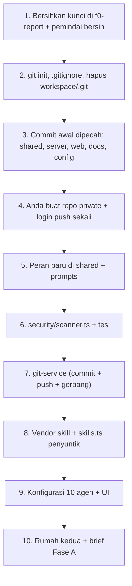

# Rencana: 5 Agen Baru, Skill Anti-Slop, Push GitHub Otomatis, dan Agen Keamanan

## Goal Description

Memperbesar kantor dari 5 menjadi **10 agen** supaya proyek 2.5D bisa dibangun oleh agen sendiri, dengan tiga syarat dari Anda:

1. **Semua agen memakai skill anti-slop** agar hasilnya tidak terlihat dibuat AI.
2. **Setiap tugas yang disetujui langsung jadi commit dan di-push ke satu repo GitHub**, supaya kontribusi Anda tercatat rutin.
3. **Ada agen Keamanan** yang memeriksa kode, `.env`, `.gitignore`, dan semua agen, dengan hak memblokir push.

Keputusan yang sudah Anda ambil dalam sesi tanya-jawab:

| Topik | Keputusan |
|---|---|
| Struktur repo | Satu repo dari root. `workspace/office-next/` ikut dilacak, sisa `workspace/` tetap diabaikan |
| Identitas commit | Murni atas nama Anda (`Muhayara <hafizhajah777@gmail.com>`) tanpa trailer `Co-authored-by` agar di GitHub tampil bersih `Muhayara committed` |
| Commit dan push | Otomatis oleh server (bukan tool agen). Satu commit per tugas yang di-ACC Laras dan per revisi. Push setelah pemindaian keamanan lolos |
| Visibilitas | Private dulu, public setelah audit penuh Satria |
| Agen baru | Gita, Wulan, Fajar, Satria, Tari (total 10) |
| Wewenang Satria | Boleh memblokir push, tidak boleh menulis file kode |
| Agen HRD | Ditunda ke fase terpisah |
| Skill | anti-slop (semua agen) + Hallmark (Tari, Wulan, Gita) |

---

## User Review Required

> [!CAUTION]
> **Status Langkah #0 (SELESAI):** Kunci API 9router lokal yang sebelumnya tertulis di `docs/f0-report.md` baris 63 telah **disensor dan diganti dengan `$env:NINEROUTER_KEY`**. Repo belum pernah di-commit atau di-push sehingga kunci tidak pernah bocor keluar. Disarankan tetap merotasi kunci lokal di dashboard `9router` (`http://127.0.0.1:20128/dashboard`) sebelum commit pertama.

> [!IMPORTANT]
> **Grafik kontribusi GitHub hanya menghitung commit yang:** (a) email penulisnya terhubung dan terverifikasi di akun GitHub Anda, (b) ada di branch utama repo yang bukan fork, dan (c) untuk repo private, hanya tampil bila **"Include private contributions on my profile"** aktif di profil Anda. Pastikan `hafizhajah777@gmail.com` terdaftar di GitHub Settings → Emails.

> [!IMPORTANT]
> **Satria tidak boleh melihat isi rahasia.** Semua prompt agen dikirim ke provider model di luar mesin ini. Karena itu pemeriksaan keamanan dijalankan oleh **pemindai deterministik di server** (kode lokal). Satria (model) hanya menerima hasil yang sudah disamarkan, misalnya `.env: NINEROUTER_KEY terdeteksi di docs/f0-report.md:63`, tanpa nilainya. Pemblokiran push **tidak bergantung pada penilaian model**: temuan keras (rahasia, `.env` tidak diabaikan) memblokir otomatis.

> [!WARNING]
> **Skill pihak ketiga tidak dipasang lewat `npx`.** Perintah `npx antislop-ai` menjalankan kode dari internet di mesin Anda. Saya mengunduh repo-nya, membaca isinya, mengunci ke satu commit SHA, lalu menyalin hanya file teks (`SKILL.md` dan referensi `.md`), tanpa skrip dan hook. Isinya diperiksa pemindai dan dibaca Satria sebelum dipakai.

> [!WARNING]
> **Perubahan menyentuh `packages/shared`**, yang ditulis DeepSeek Harness. Saya catat di `docs/deepseek-sync.md` supaya DeepSeek tahu daftar peran sudah berubah.

---

## Open Questions

> [!NOTE]
> Hal-hal kecil di bawah ini sudah saya beri nilai bawaan. Jawab hanya jika ingin lain.

1. **Nama repo:** bawaan `office-agents`. Anda yang membuat repo kosongnya di GitHub (saya tidak punya akses akun Anda), lalu memberi URL-nya.
2. **Model per agen baru:** lihat tabel di bawah. Tari sengaja memakai Sonnet 5.5 supaya tidak semua desainer menumpuk di kuota Argon 4 (yang mingguan dan sudah terpakai di akun `goblk`).
3. **Batas global:** `globalReqPerDay` 400 → 3000 dan `globalReqPerMin` 30 → 60. Kuota Antigravity tetap batas sebenarnya, karena 9router berpindah akun saat kena limit.

---

## Proposed Changes

### Komponen A: Perbaikan awal dan fondasi repo

#### [MODIFY] docs/f0-report.md
Ganti kunci di baris 63 dengan `$env:NINEROUTER_KEY`.

#### [MODIFY] .gitignore
Sekarang `workspace/` diabaikan seluruhnya. Diubah supaya hanya `office-next` yang dilacak:

```gitignore
node_modules/
.npm-cache/
dist/
data/
.env
.env.*
!.env.example
*.log
*.pem
*.key
*.sqlite
*.db

# workspace: abaikan semuanya kecuali proyek yang dibangun agen
workspace/*
!workspace/office-next/
!workspace/README.md
```

#### [DELETE] workspace/.git
Repo git bersarang yang sekarang hanya berisi satu commit "Initial workspace". Bila dibiarkan, tool `git_diff`/`git_commit` agen berjalan di repo yang salah. Setelah dihapus, `git` di dalam `workspace/` otomatis memakai repo root.

#### [NEW] git init di root
`git init -b main`, `user.name`/`user.email` lokal diisi, lalu **commit pertama setelah pemindai bersih**. Commit pertama dipecah menjadi beberapa commit atomik (shared, server, web, docs, config) supaya riwayat berguna, bukan satu commit raksasa.

---

### Komponen B: `packages/shared` (peran baru & syarat kontrak v1.1.0)

#### [MODIFY] events.ts
```ts
export const AGENT_ROLES = [
  'manager', 'researcher', 'writer', 'coder', 'reviewer',
  'gamedev', 'artist', 'visual_qa', 'security', 'designer',
] as const;
```

#### [MODIFY] index.ts
- Naikkan `SCHEMA_VERSION` dari `'1.0.0'` ke `'1.1.0'`.
- `ROLE_LABELS` (id/en) untuk lima peran baru.
- Pusatkan seluruh matriks izin sebagai konstanta data di `packages/shared/src/index.ts` (bukan hardcode di server):
  - `FILE_WRITING_ROLES = ['writer', 'coder', 'gamedev', 'artist', 'designer']`
  - `COMMAND_ROLES = ['coder', 'gamedev', 'artist', 'designer', 'visual_qa']`
  - `SECURITY_SCAN_ROLES = ['security']`
- **Tidak** ditulis oleh `security` dan `visual_qa` (mereka membaca dan menjalankan pemeriksaan saja).

Matriks izin:

| Peran | Baca file | Tulis file (`FILE_WRITING_ROLES`) | `run_command` (`COMMAND_ROLES`) | `security_scan` (`SECURITY_SCAN_ROLES`) | Hak veto push |
|---|:--:|:--:|:--:|:--:|:--:|
| gamedev, artist, designer | ya | ya | ya (Approval) | tidak | tidak |
| visual_qa | ya | tidak | ya (Allowlist khusus Playwright tanpa spam approval) | tidak | tidak |
| **security** | ya | **tidak** | tidak | **ya** | **ya** |

#### [MODIFY] tools.ts
- Tambah kategori `'security'` ke `TOOL_CATEGORIES` (`'bus' | 'task' | 'file' | 'shell' | 'control' | 'security'`).
- Tambah tool `security_scan` di bawah kategori `'security'` (hanya peran `security`). Hasilnya disamarkan.

---

### Komponen C: `apps/server`

#### [NEW] src/security/scanner.ts (deterministik)
Pemeriksaan lokal, tanpa model:

| Pemeriksaan | Aturan | Tingkat |
|---|---|---|
| `.env` ada **dan** diabaikan | `git check-ignore .env` harus sukses | KERAS |
| `.gitignore` memuat pola wajib | `.env`, `node_modules/`, `data/`, `*.pem`, `*.key`, `*.db` | KERAS |
| Rahasia di file yang akan di-commit | pola `sk-…`, `GOCSPX-`, `AIza…`, `gsk_…`, `ya29.`, `-----BEGIN … PRIVATE KEY-----`, `Bearer …` + entropi tinggi | KERAS |
| File terlarang dalam staging | `.env`, `*.pem`, `data/*.db` | KERAS |
| Izin agen | peran tanpa izin tulis tidak punya tool tulis; `ALLOWED_COMMANDS` tidak berubah tanpa catatan | KERAS |
| Prompt injection di skill dan prompt | pola `ignore previous`, perintah `curl/wget/Invoke-WebRequest`, `eval`, `base64 -d`, `postinstall` | SEDANG |
| Dependensi | `npm audit --omit=dev` | SEDANG |

Keluaran: JSON `{rule, severity, path, line}` **tanpa nilai rahasia**.

#### [NEW] src/git/git-service.ts
```ts
// Dipanggil scheduler saat tugas berpindah review -> done (ACC Laras) dan saat revisi
async function commitAndPush(task: Task, authors: AgentConfig[]) {
  const staged = await stage(task.paths);            // hanya path tugas, di bawah workspace/office-next
  const scan = await scanner.run({ staged });        // pemindai deterministik
  if (scan.hard.length) return block(task, scan);    // KERAS = berhenti, push diblokir
  await git.commit({
    message: conventionalMessage(task),              // feat(2.5d): ...
    author: 'Muhayara <hafizhajah777@gmail.com>',    // murni atas nama Muhayara tanpa trailer Co-authored-by
  });
  const pre = await scanner.run({ range: 'origin/main..HEAD' });
  if (pre.hard.length) return block(task, pre);
  await git.push('origin', 'main');                  // kredensial dari Git Credential Manager
}
```
- Token GitHub **tidak pernah** dibaca server maupun agen. Git Credential Manager meminta login browser satu kali.
- Push gagal (offline, 403): commit tetap lokal, banner di UI, dicoba ulang dengan jeda bertahap.
- Temuan KERAS: push diblokir, `Satria` mengirim pesan ke Raka dan CEO, kartu Approval muncul di UI. Hanya Anda yang bisa membuka blokir.

#### [MODIFY] src/core/office-core.ts
- Tool `git_commit` agen diganti: agen tetap bisa `git_status`/`git_diff`, tetapi commit dan push dikerjakan `git-service`. Semua perintah git dibatasi ke path `workspace/office-next` (`-- .`).
- Tool `security_scan` ditambahkan dengan penyamaran keluaran.

#### [NEW] src/skills.ts (penyuntik skill)
- Membaca `skills/vendor/<nama>@<sha>/DIGEST.md` dan menyisipkannya ke system prompt sesuai peran.
- Memakai **ringkasan** (DIGEST) per skill, bukan seluruh `SKILL.md`, supaya prompt tidak membengkak.

| Skill | Peran yang memakai |
|---|---|
| anti-slop (core + copywriting + code + human) | **semua 10 agen** |
| Hallmark (anti-slop desain) | Tari, Wulan, Gita |
| `frontend-design`, `webapp-testing` (sudah terpasang) | Tari, Fajar |
| `canvas-design`, `algorithmic-art` (Anthropic) | Wulan, Gita |

#### [MODIFY] src/prompts.ts
Tambah prompt Bahasa Indonesia untuk lima peran baru, mengikuti format `docs/PROMPTS.md`. Prompt Satria memuat larangan eksplisit: tidak boleh meminta, mencetak, atau menyalin nilai rahasia.

#### [MODIFY] src/core/scheduler.ts
Naikkan batas kursi paralel dari 2 menjadi 3. `maxStepsPerTurn` 8 → 16 dan `maxTurnsPerTask` 20 → 40 (tugas grafis lebih panjang).

---

### Komponen D: Konfigurasi (Matriks 3-Tier Berdasarkan Beban Kerja)

#### [MODIFY] office.config.json
Saat ini sudah ada **4 akun Antigravity Pro aktif** di `9router` (`corvusdua@gmail.com`, `gobloknya55555@gmail.com`, `corvustiga@gmail.com`, `hafizhmn24@gmail.com` + akun tambahan teman yang bisa langsung ditambahkan kapan saja). Agar kuota keempat akun tersebut termanfaatkan paling efisien tanpa mengorbankan kualitas, ke-10 kursi dibagi menjadi **3 Tier Berdasarkan Berat Pekerjaan**:

1. **Tier 1 — Pekerjaan Berat (Ngoding, Engine 2.5D, Desain UI/UX, Seni Visual):** Memakai `Opus 5.5 High`, `Sonnet 5.5 High`, dan `Argon 4 High`.
2. **Tier 2 — Pemeriksaan Kualitas & Keamanan (Gatekeepers):** Memakai `Argon 4 High` dan `Sonnet 5.5 High`.
3. **Tier 3 — Pekerjaan Ringan / Frekuensi Tinggi (Koordinasi, Riset, Dokumentasi, Cek Visual):** Memakai `Gemini 3.8 Flash High` agar cepat dan menghemat kuota `Opus 5.5` / `Argon 4` untuk pekerjaan berat.

| Kursi | Peran | Tier Beban Kerja | Model Utama (`primary`) | Cadangan (`fallbacks`) | `dailyCap` |
|---|---|---|---|---|---:|
| **Bima** | `coder` | **Berat** (Ngoding Core) | `ag/claude-opus-5-5-high` | `ag/claude-sonnet-5-5-high`, `ag/gemini-4-argon-high`, `ag/gemini-3.8-flash-high` | 250 |
| **Gita** | `gamedev` | **Berat** (Engine 2.5D) | `ag/claude-opus-5-5-high` | `ag/claude-sonnet-5-5-high`, `ag/gemini-4-argon-high`, `ag/gemini-3.8-flash-high` | 250 |
| **Tari** | `designer` | **Berat** (Desain UI/UX) | `ag/claude-sonnet-5-5-high` | `ag/gemini-4-argon-high`, `ag/claude-opus-5-5-high`, `ag/gemini-3.8-flash-high` | 250 |
| **Wulan** | `artist` | **Berat** (Sprite/SVG 2.5D) | `ag/gemini-4-argon-high` | `ag/claude-sonnet-5-5-high`, `ag/gemini-3.8-flash-high` | 250 |
| **Laras** | `reviewer` | **Kritis** (Review & QA) | `ag/gemini-4-argon-high` | `ag/claude-sonnet-5-5-high`, `ag/gemini-3.8-flash-high` | 300 |
| **Satria** | `security` | **Kritis** (Audit Keamanan) | `ag/claude-sonnet-5-5-high` | `ag/gemini-4-argon-high`, `ag/gemini-3.8-flash-high` | 250 |
| **Raka** | `manager` | **Ringan/Sering** (Dispatch) | `ag/gemini-3.8-flash-high` | `ag/gemini-4-argon-high`, `ag/claude-sonnet-5-5-high` | 350 |
| **Sari** | `researcher` | **Ringan/Sering** (Riset) | `ag/gemini-3.8-flash-high` | `ag/gemini-4-argon-high`, `ag/claude-sonnet-5-5-high` | 300 |
| **Dimas** | `writer` | **Ringan/Sering** (Dokumen) | `ag/gemini-3.8-flash-high` | `ag/claude-sonnet-5-5-high`, `ag/gemini-4-argon-high` | 300 |
| **Fajar** | `visual_qa` | **Ringan/Sering** (Cek Visual) | `ag/gemini-3.8-flash-high` | `ag/gemini-4-argon-high`, `ag/claude-sonnet-5-5-high` | 300 |

Bagian baru:
```json
"git": {
  "remote": "origin", "branch": "main", "autoPush": true,
  "authorName": "Muhayara", "authorEmail": "hafizhajah777@gmail.com",
  "scope": "workspace/office-next",
  "blockedFiles": ["package.json", "package-lock.json"]
},
"limits": { "globalReqPerMin": 60, "globalReqPerDay": 3000,
            "maxStepsPerTurn": 16, "maxTurnsPerTask": 40 }
```

---

### Komponen E: Skill pihak ketiga (prosedur ketat)

#### [NEW] skills/vendor/`<nama>@<sha>`/
Untuk `miqdadbadjuber/anti-slop` (8.905 bintang, MIT) dan `Nutlope/hallmark` (52.813 bintang, MIT):

1. Clone dangkal ke folder sementara **di luar repo**, catat commit SHA.
2. Saya baca `SKILL.md`, referensi, dan semua skrip. Pemindai memeriksa pola berbahaya.
3. Salin hanya file `.md` ke `skills/vendor/<nama>@<sha>/`, tambah `LICENSE` asli dan `SOURCE.md` (URL, SHA, tanggal, hasil pemeriksaan).
4. Buat `DIGEST.md` (aturan inti, ringkas) untuk disuntikkan ke prompt.
5. Skrip `sloplint` milik Hallmark **tidak** dijalankan dulu. Bisa ditambahkan nanti sebagai langkah Fajar setelah dibaca.

Bintang saya cek langsung ke GitHub, tetapi **isi dan keamanannya baru saya nilai setelah dibaca**, bukan dari popularitasnya.

---

### Komponen F: UI (`apps/web`)

#### [MODIFY] StatusRail.tsx, RosterRow.tsx, DetailRail.tsx
- Teks "Employee Seats (5)" menjadi dinamis (jumlah dari snapshot).
- Lencana Git di bar atas: cabang, waktu push terakhir, jumlah commit belum terkirim, status "push diblokir".
- Panel temuan Satria di rail kanan (hanya `rule`, `path`, `line`).

---

### Komponen G: Rumah kedua dan dokumentasi

#### [NEW] workspace/office-next/
Proyek ruang kerja agen yang **mengimpor `@office/shared` langsung dari root monorepo** (tidak menyalin `packages/shared` agar tidak terjadi *contract drift*), dan dilengkapi *feature-flag / view switch* agar kanvas 2.5D dapat ditampilkan langsung di samping Meja Dispatch maupun diuji mandiri di port `:5183`. `git-service` memblokir auto-commit terhadap `package.json` dan `package-lock.json` tanpa persetujuan CEO. Brief Fase A untuk Raka ditulis di `docs/plans/brief-fase-a-2.5d.md`.

#### [MODIFY] ARCHITECTURE.md, seat-matrix.md, README.md, docs/deepseek-sync.md
Dokumentasikan roster 10 agen, alur commit-push, dan pemindai.

---

### Fase HRD (ditunda, hanya rancangan)

Dikerjakan **setelah** 10 agen berjalan stabil. Ringkasan rancangan agar keputusan hari ini tidak mengunci kita:
- Tool `propose_hire` (hanya peran HRD): mengusulkan peran, persona, model, skill. **Tidak** membuat agen sendiri.
- Agen aktif hanya setelah Anda setujui di kartu Approval.
- Batas maksimal jumlah agen (misalnya 16) dan perubahan config tercatat sebagai commit.
- Prasyarat: daftar agen harus dinamis (sekarang tetap di `office.config.json` dan enum `AGENT_ROLES`).

---

## Urutan Pengerjaan (setiap langkah jadi commit tersendiri)



Dengan pola ini riwayat GitHub Anda terisi sejak langkah 3, dan setiap langkah di atas dikirim sebagai commit sendiri.

---

## Verification Plan

### Automated Tests
```powershell
npm run typecheck
npm run test
```
Tes baru di `apps/server/src/`:
- `scanner.test.ts`: file fixture berisi **kunci palsu** dan `.env` yang tidak diabaikan harus diblokir; repo bersih harus lolos; nilai rahasia tidak boleh muncul di keluaran.
- `git-service.test.ts`: repo sementara + remote bare lokal. Memastikan satu commit per tugas, penulis dan trailer benar, push diblokir saat ada temuan KERAS, commit tetap lokal saat push gagal.
- `roles.test.ts`: `security` dan `visual_qa` ditolak saat memakai `write_file`; peran tulis dibatasi ke `workspace/office-next`.
- `skills.test.ts`: penyuntik memasukkan DIGEST sesuai peran dan tidak melebihi batas panjang.
- E2E dengan `mock-driver`: 10 agen menjalankan satu tugas sampai ACC dan menghasilkan satu commit lokal.

### Manual Verification
1. Buat repo **private** kosong di GitHub, berikan URL-nya. Saya jalankan `git remote add origin ...`, lalu push pertama (login browser sekali).
2. Aktifkan **Include private contributions** di profil GitHub, pastikan email Anda terverifikasi.
3. Kirim perintah kecil ke Raka. Setelah Laras ACC, cek di GitHub: ada commit atas nama Anda dengan trailer `Co-authored-by`.
4. **Uji blokir:** taruh file dengan kunci palsu di `workspace/office-next`, lalu selesaikan tugas. Push harus diblokir, banner muncul, dan Satria melapor tanpa menampilkan nilai kunci.
5. Hapus `.env` dari `.gitignore` sementara. Pemeriksaan KERAS harus menolak push.
6. Cek di UI: roster menampilkan 10 kursi dan lencana Git.
